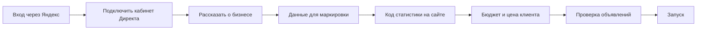

# Спецификация продукта

## 1. Пользователь

Владелец маникюрного салона, йога-студии или похожего локального бизнеса. Знает своих клиентов, цены и район. Не знает слов «ставка», «РСЯ», «конверсия». Заходит редко, часто с телефона, поэтому интерфейс должен работать с шириной экрана от 360 px.

**Главная задача:** получать клиентов за понятные деньги и видеть, что бюджет расходуется честно.

**Главные страхи [гипотеза, проверить на интервью]:** «спишут лишнее», «реклама сделает что-то без спроса», «не понимаю, работает ли это».

## 2. Принципы интерфейса

1. **Язык бизнеса.** В интерфейсе нет терминов площадок. Если термин неизбежен, рядом стоит пояснение.
2. **Один главный вопрос на экран.** Настройка разбита на короткие шаги.
3. **Есть разумное значение по умолчанию.** Пользователь подтверждает предложение, а не заполняет форму с нуля.
4. **Деньги всегда на виду.** Бюджет, потрачено, осталось и стоимость клиента.
5. **Каждое действие системы объяснено.** Что сделано, почему, что будет дальше, как отменить.
6. **Честность о данных.** «Пока мало данных для вывода» лучше красивой, но ложной цифры.

### Словарь интерфейса

| Термин площадки | Текст для пользователя |
|---|---|
| Конверсия, лид | Обращение |
| CPL | Цена обращения |
| CAC | Цена клиента |
| Кампания | Рекламный поток или название направления |
| Группа, таргетинг | Аудитория |
| РСЯ | Реклама на сайтах и в приложениях |
| Модерация | Проверка Яндексом |
| Счётчик Метрики | Код статистики на сайте |
| A/B-тест | Проверка: какой вариант лучше |

## 3. Сценарии

### С1. Первый запуск: цель — запуск без посторонней помощи

| Шаг | Что видит пользователь | Что делает система | Ошибки и подсказки |
|---|---|---|---|
| Вход | «Войти через Яндекс» | Создаёт учётную запись | Отказ в доступе: «Без входа мы не сможем сохранить настройки» |
| Кабинет | «Подключите рекламный кабинет» и подсказка, что это такое. Показывается выбранный логин Яндекса | OAuth `direct:api` и `metrika:*`, проверка доступа, отображение остатка | Нет кабинета: пошаговая инструкция. Выбран не тот логин: «Сменить аккаунт» |
| Бизнес | Ссылка на сайт или карточку, затем уточнения: услуги, цены, адрес, район, что отличает вас | Разбирает сайт и предзаполняет поля | Сайт не открылся: заполнение вручную |
| Маркировка | «По закону реклама должна быть промаркирована. Это делает Яндекс, ему нужны ваши данные»: тип, ИНН, название | `Clients.update` | Проверка контрольной суммы ИНН. Один бизнес на логин |
| Статистика | «Вставьте этот код на сайт» + инструкции для Tilda, WordPress, Taplink и т. п., либо «Отправить разработчику» | Создаёт или переиспользует счётчик и цели, проверяет установку | Кнопка «Проверить», конкретная причина неудачи |
| Бюджет | «Сколько вы готовы тратить в месяц?» и прогноз диапазона обращений | Считает минимум и прогноз | При низком бюджете честно предупреждает |
| Цена клиента | «Средний чек?», «Сколько можно отдать за нового клиента?» с предложенным значением | Задаёт целевую цену обращения | |
| Объявления | 3–5 готовых карточек как на реальных площадках; можно изменить текст, заменить фото, отказаться | Генерация, проверка правил | |
| Запуск | Итог: сколько, где, когда первые показы. Напоминание пополнить кабинет | Создаёт кампании, отправляет на проверку | Баланс ноль: инструкция |

**Требование:** перерыв в любом шаге не теряет данные; продолжение с того же места.

### С2. Ежедневная работа

Главная страница отвечает на вопросы в таком порядке:
1. **Всё ли в порядке:** «Реклама работает» или конкретная проблема с кнопкой решения.
2. **Что получено:** расходы, обращения, клиенты, цена клиента за выбранный период.
3. **Что изменилось:** последние действия системы.
4. **Деньги:** потрачено X из Y, прогноз до конца периода, остаток в кабинете.

### С3. Изменение настроек простым языком

Типовые настройки в виде форм: бюджет, пауза, район, часы работы, услуги, цена клиента, запрет слов и картинок.

Также есть строка свободного ввода: «не показывайте рекламу по воскресеньям», «добавьте услугу педикюр». Модель переводит текст в **закрытый набор команд**, система показывает итог: «Я поняла так: отключить показы в воскресенье. Применить?» и только после подтверждения выполняет через журнал. Всё, что вне набора команд, получает честный отказ с предложением ближайшей настройки.

### С4. История и откат

Лента событий. Каждая запись:

> **Отключено объявление «Маникюр с покрытием за 1 500 ₽»**
> За 12 дней потрачено 1 840 ₽, обращений нет, при вашей цене обращения 400 ₽. Другие объявления за то же время принесли 5 обращений.
> Сэкономленные деньги переданы объявлению «Первый визит со скидкой».
> [Подробнее] [Отменить]

Отмена показывает последствия: «Объявление снова включится. Бюджет не вырастет: оно разделит его с другими». Если отмена невозможна, это объяснено.

### С5. Проверка: какой вариант лучше

Карточка теста:
- Вопрос: «Что приводит больше обращений: акцент на цене или на результате?»
- Варианты и их показатели, ход теста и причина его запуска.
- Вывод обычным языком, степень уверенности и применённое решение.
- Если данных не хватило, так и сказано; система всё равно выбирает безопасный вариант, а не держит тест бесконечно.

### С6. Проблемы, о которых система говорит сама

Нулевой баланс, отказ проверки Яндекса, пропавший код статистики, истёкший доступ, бюджет на исходе, сбой площадки. Каждая проблема содержит причину, решение и ссылку. Уведомления: письмо всегда, Telegram, если владелец подключил бота на экране «Уведомления». О каждой проблеме пишем один раз, пока она не решится.

## 4. Экраны

| Экран | Содержание |
|---|---|
| Вход | Польза, кнопка входа, ссылка на политику данных |
| Мастер настройки | Шаги С1 и индикатор прогресса |
| Главная | С2 |
| Статистика | Период, показатели, разбивка по направлениям и площадкам, таблица, время обновления данных, сверка с кабинетом |
| Реклама | Направления, объявления, статус простыми словами, действия |
| Проверки | С5 |
| История | С4, фильтры |
| Настройки | С3, кабинеты, бизнес, маркировка, код статистики |
| Служебная настройка | Ключи приложений и параметры задаются конфигурацией |

## 5. Показатели на экране статистики

| Показатель | Источник | Подпись и точность |
|---|---|---|
| Расходы | `Reports` площадки | Совпадает с кабинетом, показывается время обновления |
| Обращения | Цели Метрики: заявка, звонок, мессенджер | Показывается модель атрибуции |
| Клиенты | Подтверждение владельца или CRM | «Подтверждено вами»; без подтверждения показываем только обращения и оценку, отмеченную как оценка |
| Цена клиента | Расходы ÷ клиенты | Показывается только при наличии подтверждённых клиентов |

**Откуда берутся клиенты.** Метрика не знает, кто дошёл до салона. Поэтому раз в неделю система спрашивает: «За неделю было 12 обращений. Сколько стали клиентами?» Ответ занимает одну кнопку. Загрузка в офлайн-конверсии Метрики предусмотрена как улучшение.

## 6. Что не входит в проект

Согласно заданию: оплата, роли и управление доступами. Пополнение кабинета происходит вне сервиса.

Также не делаем в первой версии: мобильное приложение, собственный конструктор сайтов, товарные фиды и рекламу интернет-магазинов.

**Открытый вопрос:** у бизнеса может не быть сайта. Базовое решение: сайт или страница, куда можно вставить код, обязательны. Возможное расширение: простая посадочная страница со встроенным счётчиком. Решение после интервью и ответа автора.
