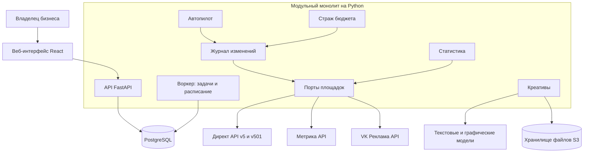
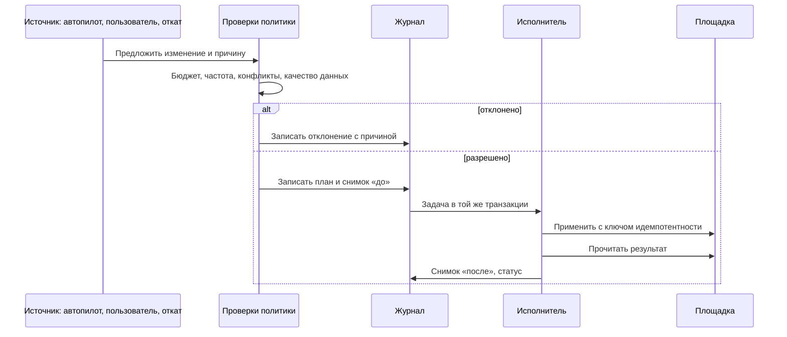
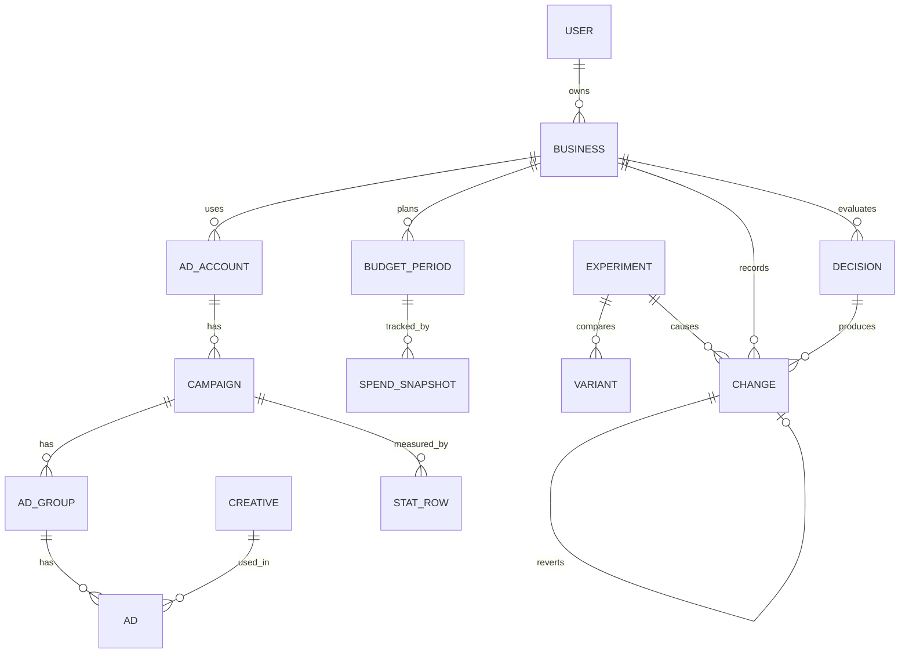

# Архитектура

## 1. Приоритеты

Порядок важности при конфликте требований:

1. **Деньги:** расход не превышает бюджет.
2. **Точность:** действия и статистика соответствуют площадке.
3. **Восстановимость:** любой сбой не ведёт к двойному выполнению и потере истории.
4. **Понятность:** пользователь понимает происходящее.
5. **Простота развёртывания:** заказчик поднимает сервис сам.

## 2. Общая схема



**Почему монолит.** Команда из одного человека, заказчик развёртывает сам, а масштаб первых лет невелик. Границы модулей проверяются линтером импортов, поэтому модуль можно будет вынести при необходимости.

## 3. Стек

| Часть | Выбор | Причина |
|---|---|---|
| Бэкенд | Python 3.12+, FastAPI, Pydantic, SQLAlchemy 2, Alembic | Быстрая разработка, сильная типизация схем API |
| Очередь и расписание | Procrastinate поверх PostgreSQL | Нет отдельного брокера; задача ставится в одной транзакции с данными |
| База | PostgreSQL 16 | Транзакции для журнала и денег |
| Фронтенд | React, TypeScript, Vite, TanStack Query, клиент из OpenAPI | Сложный мастер и графики; типы из общего контракта |
| Файлы | S3-совместимое хранилище; MinIO в Compose | Переключается конфигурацией |
| Видео и изображения | Pillow, FFmpeg, Playwright для рендера шаблонов | Точный контроль текста на креативах |
| Прокси и TLS | Caddy | Автоматический сертификат |
| Развёртывание | Docker Compose | Один понятный сценарий |
| Наблюдаемость | Структурные логи, Sentry-совместимые ошибки (необязательно), `/healthz`, панель служебных проверок | Минимум внешних зависимостей |

Языковая модель скрыта за портом. Значение по умолчанию выбирается на этапе 5 среди доступных из РФ, начиная с Yandex AI Studio. Провайдер задаётся конфигурацией.

## 4. Модули

Правило зависимостей: `api → application → domain`, а `adapters` реализуют порты из `domain`. Доменный код не знает HTTP и SDK площадок.

```text
src/adhelper/
  accounts/      вход, пользователи, подключённые кабинеты, токены
  business/      профиль бизнеса, разбор сайта
  platforms/     порт AdPlatform и адаптеры yandex_direct, vk_ads
  analytics/     порт AnalyticsProvider и адаптер yandex_metrika
  campaigns/     целевая модель кампании и согласование с площадкой
  creatives/     концепции, тексты, изображения, видео, проверки
  budget/        планирование, ограничения, страж бюджета
  autopilot/     оценка эффективности, правила, предложения действий
  experiments/   A/B-тесты
  ledger/        журнал изменений, выполнение, откат
  stats/         загрузка, хранение и сверка статистики
  commands/      перевод обычного текста в разрешённые команды
  notifications/ письма и внутренние уведомления
  api/           HTTP-слой
  worker/        расписание и регистрация задач
  config.py      настройки из окружения
  db.py          подключение к базе и базовый класс моделей
```

Каждый бизнес-модуль делится на `domain`, `application` и `adapters`. Правила записаны контрактами `import-linter` в `pyproject.toml`: домен не импортирует HTTP, SDK, ORM и внешние слои; `adapters` и `application` не зависят друг от друга; `api` и `worker` не обращаются к домену напрямую; модули не зависят от `api` и `worker`. Новый модуль нужно добавить в списки контрактов.

Миграции в Compose выполняет отдельная разовая служба `migrate`, приложение стартует после её успешного завершения.

### Порт площадки

Глубокий интерфейс: автопилот работает с нашими понятиями, а особенности площадки остаются в адаптере.

```python
class AdPlatform(Protocol):
    def capabilities(self) -> PlatformCapabilities: ...
    async def apply(self, account: AccountRef, change: PlannedChange) -> AppliedChange: ...
    async def read_state(self, account: AccountRef, scope: Scope) -> PlatformState: ...
    async def fetch_spend(self, account: AccountRef, period: Period) -> SpendSnapshot: ...
    async def fetch_stats(self, account: AccountRef, query: StatsQuery) -> StatsRows: ...
    async def fetch_balance(self, account: AccountRef) -> Balance: ...
    async def set_advertiser_identity(self, account: AccountRef, identity: AdvertiserIdentity) -> None: ...
```

`capabilities()` сообщает, какие лимиты бюджета и действия доступны, поэтому площадке без функции не требуется особый код в автопилоте.

## 5. Ключевой поток: как выполняется изменение

Единственный путь изменить что-либо на площадке:



Свойства:
- **Идемпотентность.** Многие методы Директа не поддерживают ключи идемпотентности, поэтому перед повтором исполнитель читает состояние и сравнивает его с целевым. Созданным объектам присваивается наша метка в имени.
- **Сбой посреди операции.** Запись остаётся в статусе `applying`, задача согласования проверяет фактическое состояние и завершает операцию. Вслепую ничего не повторяется.
- **Журнал как очередь.** Запись `planned` сама является заданием: она фиксируется вместе с данными и не теряется при падении, а согласование находит её по статусу. Отдельная задача Procrastinate для выполнения не нужна; он понадобится для расписания.
- **Повторная проверка политики.** Прямо перед применением бюджет проверяется заново по свежим данным: разрешение, полученное до сбоя, могло устареть, а застрявшее увеличение не видно при проверке следующего. Отказ завершает запись статусом `failed`.
- **Порядок.** Записи аккаунта выполняются по очереди, незавершённая задерживает следующие, поэтому увеличение не обгонит снижение. Остановка кампаний идёт вне очереди.
- **Защита от гонок.** На аккаунт одновременно выполняется одна изменяющая задача (рекомендательная блокировка PostgreSQL).
- **Внешние правки.** Если пользователь поменял что-то в кабинете, `Changes` это покажет: система записывает событие «изменено вне сервиса», принимает новое состояние и не перезаписывает его автоматически без уведомления.

## 6. Модель данных



| Таблица | Основные поля |
|---|---|
| `users` | `yandex_uid`, `email`, `consent_at` |
| `businesses` | `user_id`, профиль JSONB, `target_cpl`, `average_check`, `status`, `autopilot_mode` |
| `ad_accounts` | `platform`, внешний логин, зашифрованные токены, срок, `scopes`, `client_login`, состояние |
| `advertiser_identity` | Зашифрованные ИНН и реквизиты, `synced_at` |
| `analytics_connections` | `counter_id`, цели и их роли, `install_verified_at` |
| `budget_periods` | Начало, конец, `hard_limit_minor`, `reserve_pct`, валюта, состояние |
| `spend_snapshots` | Период, площадка, сумма, момент замера, момент данных, источник |
| `campaigns`, `ad_groups`, `ads` | `external_id`, `desired_state`, `actual_state`, `moderation_state`, поля назначения |
| `creatives` | Тип, тексты, файлы, концепция, проверки, внешний хэш |
| `stat_rows` | Дата, уровень объекта, показы, клики, расход с точностью площадки, обращения, `attribution_model`, `fetched_at`, флаг `settled` |
| `client_confirmations` | Неделя, количество, источник |
| `decisions` | Объект, вход (снимок метрик), версия правил, результат, вероятности |
| `changes` | `business_id`, источник, `decision_id`, тип, `target_ref`, `before`, `planned`, `after`, статус, объяснение, `reverts_change_id`, `idempotency_key` |
| `experiments`, `variants` | Вопрос, тип, расписание, метрика, результаты, вывод, решение |
| `data_health` | Площадка, показатель, состояние, момент |

**Деньги** хранятся в целых значениях: в микроединицах площадки для статистики и лимитов. Вещественные числа запрещены линтером для денежных полей.

**Журнал неизменяем.** В `changes` разрешены только добавление и переход статуса; `before`, `planned` и объяснение закрыты триггером PostgreSQL.

## 7. Фоновые задачи

| Задача | Частота | Назначение |
|---|---|---|
| `budget.watch` | Запуск каждые 5 минут; сам период решает по `next_check_at`, пора ли проверять: обычно 15 минут, у порога 5 | Сверка расхода и счёта, остановка при риске превышения |
| `stats.sync_recent` | Каждый час | Сегодня и вчера |
| `stats.reconcile` | Раз в день | Последние 3–7 дней и сигнал `STAT` |
| `state.reconcile` | Каждые 5 минут: журнал; каждый час: состояние и модерация | Завершение незавершённых изменений, сравнение целевого и фактического состояния |
| `health.evaluate` | Каждый час | Качество данных, сбои, пропажа кода статистики |
| `autopilot.evaluate` | Раз в день, утро МСК | Оценка и план действий |
| `experiments.tick` | Два раза в день | Переключение вариантов, завершение |
| `tokens.refresh` | Раз в день | Обновление токенов, предупреждение |
| `clients.prompt` | Раз в неделю | Запрос подтверждения клиентов |

Период наблюдения стража сокращается по мере приближения к лимиту. Задачи учитывают баллы площадки: денежные проверки имеют приоритет, а при недостатке баллов откладывается оптимизация, но не контроль бюджета.

## 8. Безопасность

| Риск | Мера |
|---|---|
| Утечка токенов | Шифрование AES-256-GCM, ключ вне базы; ключи версионируются, поддерживается смена; токены нигде не логируются |
| Подмена OAuth | `state`, PKCE, если поддерживается провайдером; проверка redirect URI |
| Сессии | HttpOnly, Secure, SameSite cookie; защита от CSRF |
| Чужие данные | Каждый запрос ограничен `business_id` на уровне репозитория; автотесты на доступ между пользователями |
| Персональные данные | Хранение в РФ; шифрование ИНН и реквизитов; не передаём в языковые модели; удаление по запросу; политика и согласие |
| Разбор сайтов (SSRF) | Запрет внутренних адресов, ограничения размера и времени, запуск в отдельном сетевом контуре |
| Инъекция подсказок из сайта | Текст сайта считается данными. Модель выбирает только закрытые команды и не управляет деньгами |
| Загрузка файлов | Проверка типа и размера, обработка в воркере, новая кодировка изображений |
| Злоупотребление генерацией | Лимиты на бизнес в сутки |

## 9. Журнал решений

| № | Решение | Причина | Отвергнутая альтернатива |
|---|---|---|---|
| 1 | Единая перфоманс-кампания как основной тип | Широкий охват одним бюджетом, поиск и сети | Отдельные текстово-графические кампании: больше настройки, остаются как запасной вариант |
| 2 | Яндекс ID как единственный вход | Тот же провайдер, что кабинет; меньше шагов | Google: не нужен для целевого сценария |
| 3 | Вход и подключение кабинета — разные потоки | Кабинет может быть на другом логине; вход не требует прав на рекламу | Один большой запрос прав |
| 4 | Бюджет на период как основной лимит | Площадка сама остановит расход, включая случай падения сервиса | Недельный лимит: при нашем сбое расход продолжится на следующей неделе |
| 5 | Метрика как система аналитики | Встроена в Директ, бесплатна, имеет API целей | Собственный трекер: долго и хуже стыкуется |
| 6 | Правила, а не модель, принимают денежные решения | Проверяемость, объяснимость, безопасность | Агент с полным доступом к API |
| 7 | Своё A/B-чередование | Нет API экспериментов, мало конверсий | Playwright в кабинете пользователя |
| 8 | Только приостановка, без удаления | Откат возможен всегда | Удаление объектов |
| 9 | PostgreSQL как очередь | Меньше частей для развёртывания | Redis и Celery |
| 11 | Строка журнала как задание на выполнение | Одна транзакция без внутренних API очереди; задание нельзя потерять | Задача Procrastinate на каждое изменение: его постановка не входит в транзакцию SQLAlchemy |
| 10 | VK Реклама — вторая площадка | Прямой API, доступная аудитория | Telegram Ads: открытый API не подтверждён; Google и Meta не рассматриваются для РФ |
