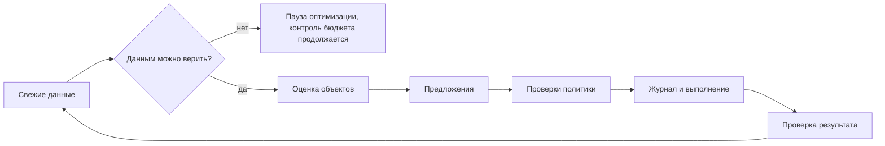
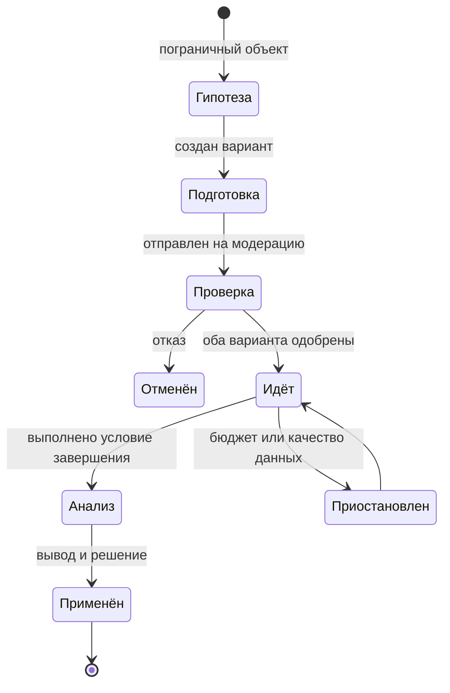

# Автопилот

Все числовые пороги ниже — стартовые значения. Они вынесены в версионируемый файл правил и калибруются на реальных кампаниях этапа 4. Версия правил записывается в каждое решение.

## 1. Рабочий цикл



**LLM не участвует в решениях о деньгах.** Модель только формулирует текст объявлений и объяснения, опираясь на посчитанные значения. Числа в объяснениях подставляются кодом и проверяются.

## 2. Страж бюджета

**Что гарантируем.** Расход за бюджетный период, по данным площадки, не превышает лимит пользователя.

**Почему этого нельзя достичь одной проверкой.** Статистика приходит с задержкой, площадка распределяет расход самостоятельно, наш сервис может упасть, а изменение лимита может создать всплеск. Поэтому используются независимые слои.

| Слой | Механизм | Что защищает |
|---|---|---|
| 1. План | Сумма лимитов не превышает рабочий бюджет `O = H × (1 − r)`; стартовый резерв `r = 10%` | Округления и неточность площадки |
| 2. Площадка | `CustomPeriodBudget` с датой окончания периода (`S2`) | Падение нашего сервиса, сбой API |
| 3. Контроль изменений | Проверка худшего случая перед любым изменением | Всплеск при смене параметров |
| 4. Наблюдение | `budget.watch` каждые 15 минут и остановка у порога | Неожиданный расход |
| 5. Перекрёстная проверка | Сверка с балансом кабинета; расхождение ведёт к остановке и тревоге | Ошибка в наших расчётах |
| 6. Запас на задержку | Порог учитывает скорость расхода и возраст данных | Запаздывание статистики |

### Проверка перед изменением

```text
spent        = расход за период по данным площадки, с поправкой на задержку
worst_active = сумма худших оставшихся расходов всех активных кампаний
worst_change = худший дополнительный расход от изменения
допустимо если: spent + worst_active + worst_change ≤ H
```

Для недельных лимитов при оплате за клики `worst_change` равен 35% старого + 35% нового лимита. **[Втор]** Стратегии с дневным расходом до 100% лимита запрещены политикой. Для лимитов периода коэффициент определяется опытом `S2`, а до этого применяется консервативная оценка.

Другие правила:
- Бюджет увеличиваем не чаще раза в неделю на кампанию и не более чем на 20–30% за шаг.
- Перенос бюджета выполняется в два шага: сначала снижение у донора, затем увеличение у получателя после подтверждения снижения.
- Откат проходит ту же проверку. Откат, который привёл бы к превышению, выполняется без роста бюджета с объяснением.

### Порог остановки

```text
projected = spent + burn_rate × (возраст данных + интервал проверки + время остановки)
projected ≥ 0.97 × H  →  приостановить все кампании периода
projected ≥ 0.90 × H  →  проверять каждые 5 минут и предупредить
```

Если API недоступен, бюджет защищён слоем 2. Сервис сообщает об этом владельцу и повторяет остановку.

Лимит площадки по умолчанию не может быть выше `O`. Поэтому порог наблюдения срабатывает лишь при поломке слоя 2.

### Бюджетный период

Значение по умолчанию: 30 дней. Новый период создаётся только после подтверждения итогов старого; неиспользованный остаток не переносится. Автопродление требует явного согласия при запуске. Расход сравнивается с лимитом на той же основе (с НДС или без), которую определит проверка `S3`. Кампании, созданные в кабинете вне сервиса, не входят в наш лимит, если их расход не включён явно: они показываются отдельной строкой с предупреждением.

## 3. Качество данных

Перед оценкой проверяем:
- Расход есть, а обращений необычно мало относительно истории.
- Метрика перестала получать визиты: код могли удалить.
- Клики Директа сильно расходятся с визитами Метрики.
- Площадка сообщила о сбое: включается флаг службы, а также ручной переключатель в настройках.

Плохое состояние переводит автопилот в режим «только защита»: разрешены остановки ради бюджета, запрещены выводы об эффективности. Октябрьский сбой 2026 года — обязательный сценарий теста: кабинет не работал, конверсии были разорваны, и система не должна была отключить хорошую рекламу из-за этого.

## 4. Оценка эффективности

### Какие данные используем

- Решения принимаем на «дозревших» данных: без последних 48 часов.
- Период обучения новых объектов: 7 дней или целевая цена × 2 расхода. До этого отключаем только при явных проблемах: отказ, сайт не работает.
- Объект: объявление, группа, кампания, площадка. Сначала оцениваем более крупный уровень, потом мелкий.

### Модель

У малого бизнеса мало обращений, а простое сравнение цен обманчиво. Поэтому оцениваем вероятность того, что цена обращения выше или ниже цели:

```text
обращения ~ Пуассон(λ · расход)
априорно: λ ~ Гамма(a, b), среднее = 1 / target_cpl, вес = 1 условное обращение
апостериорно: λ ~ Гамма(a + обращения, b + расход)
P_good = P(1/λ ≤ target_cpl)
P_bad  = P(1/λ ≥ 1.3 × target_cpl)
```

| Класс | Условие | Действие |
|---|---|---|
| Эффективно | `P_good ≥ 0.8` | Увеличить бюджет, если есть резерв и показы ограничены бюджетом |
| Неэффективно | `P_bad ≥ 0.9`, расход ≥ 2 × цели | Приостановить. Создать замену, если объектов мало |
| Пограничное | Расход ≥ цели, остальные условия не выполнены | Запустить A/B-тест |
| Мало данных | Расход ниже порога | Ждать, выделять минимально достаточный бюджет |

Если обращений совсем нет, но есть визиты, используем сигнал `micro`, но только для сравнения вариантов, а не для оценки цены обращения.

Сделаем поправку на подтверждённых клиентов, когда они есть: цель по клиенту пересчитываем через фактическую долю обращений, ставших клиентами.

### Действия и ограничения

| Действие | Ограничения |
|---|---|
| Приостановить объявление | В группе остаётся минимум одно рабочее |
| Приостановить группу или кампанию | Освобождённый бюджет переносится или возвращается в резерв |
| Увеличить бюджет | Проверка худшего случая, не более раза в неделю |
| Создать объявление | Из одобренной концепции, проверка правил |
| Минус-слова и фразы | Из отчёта поисковых запросов, с журналом |
| Корректировки времени и устройств | Только при явных отличиях и достаточном объёме |

Ограничитель частоты: на кампанию не более одного существенного изменения за цикл, не менее 3 дней между изменениями, чтобы не мешать обучению стратегии.

### Режимы

`auto` — действует сам и сообщает (по умолчанию, как требует задание). `confirm` — спрашивает перед действиями с деньгами. `pause` — только наблюдает.

## 5. A/B-тесты

### Почему свой механизм

Эксперименты Директ Про не найдены в API. Создание сегментов через Аудитории закрыто. В одной группе ротация Директа сама смещает показы к лучшему по её мнению варианту, что искажает сравнение. Подробности в [исследовании](00-research.md#3-ab-эксперименты-директ-про).

### Типы

**Тест объявлений: чередование (switchback).** Одна кампания и одна аудитория. Варианты поочерёдно активны в сбалансированном по дням порядке, например `A B B A B A A B`.
- Плюсы: работает через публичный API и на малом бюджете, одинаковая аудитория, одинаковый аукцион, управление через `Ads.suspend` и `resume`.
- Минусы: влияние времени снижается балансировкой, но полностью не исчезает; возможен перенос эффекта обучения стратегии. На первые часы после смены действует исключающий интервал.
- `S7` проверяет, как приостановка влияет на обучение и модерацию. Если влияние вредно, переключаемся на запасной вариант.

**Тест аудиторий: параллельные группы.** Для сравнения разных аудиторий чередование не нужно: они сами разные. Группы получают один и тот же креатив, а анализ учитывает, что разделение бюджета не случайно. В выводе обязательно: «сравнение наблюдательное».

**Запасной вариант:** параллельные копии с равными лимитами в отдельных кампаниях. Менее чистый метод, используем при отрицательном результате `S7`.

### Ход теста



**Запуск:** не более одного теста на кампанию, если хватит бюджета на минимальный объём.

**Гипотезы** формулируются моделью из закрытого списка: оффер, цена, выгода или результат, социальное доказательство, изображение, призыв. Ограничение — один параметр за тест.

**Метрика:** обращения. Если за неделю обращений мало, основной метрикой становится `micro`-сигнал, а вывод это обязательно называет.

**Анализ:**

```text
По вариантам: успехи s, клики n
p ~ Бета(1 + s, 1 + n − s)
P(B лучше A) и ожидаемая разница считаются выборкой из апостериорного распределения
Также цена результата: расход ÷ успехи
```

Завершение при первом выполнении условий:
- `P(B лучше A) ≥ 0.9` или `≤ 0.1`, не менее 7 дней и минимум по кликам на вариант;
- максимальная длительность, стартово 21 день;
- максимальные траты на тест.

**Решение применяется всегда:**

| Результат | Решение | Пример объяснения |
|---|---|---|
| Победитель | Победитель активен, проигравший приостановлен | «С вероятностью 93% вариант с отзывами лучше» |
| Разницы не найдено | Оставляем дешевле по цене результата или простой вариант | «Разница мала, поэтому оставили вариант с меньшей ценой обращения» |
| Данных мало | Сохраняем контроль и новая гипотеза | «Данных мало, проверка не подтвердила улучшение. Оставили прежний вариант» |

Важно не завышать уверенность: промежуточные значения не показываются как окончательные выводы.

## 6. История и откат

### Что считается изменением

Любое действие на площадке: от автопилота, пользователя, A/B-теста, отката и изменений вне сервиса. Запись содержит снимки, причину, входные данные решения и версию правил.

### Как строится объяснение

1. Код формирует структуру фактов: `spent=1840, leads=0, target=400, days=12`.
2. Шаблон выдаёт надёжный текст. Модель необязательна для перефразирования, но после неё проверяем, что все числа совпадают с фактами; при ошибке остаётся шаблон.

### Откат

Откат создаёт новую запись-операцию, старая остаётся. Шаги:

1. Прочитать текущее состояние объекта и сравнить с `after` исходной записи.
2. Если объект изменён позже, показать это и предложить откат с учётом зависимых действий.
3. Пропустить целевое состояние через проверки политики.
4. Выполнить и подтвердить чтением.

| Тип изменения | Откат |
|---|---|
| Пауза и запуск | Обратное действие |
| Бюджет, стратегия, настройки | Возврат значения через проверку бюджета |
| Новое объявление | Приостановка и архивирование, без удаления |
| Правка объявления | Возврат полей, требуется модерация, предупреждаем |
| Минус-слова, фразы | Обратное изменение списка |
| Завершение теста | Включение прежнего варианта |
| Потраченные деньги и данные обучения | Нельзя вернуть, интерфейс говорит об этом честно |
| Завершённый бюджетный период | Откат недоступен, объяснение |

После отката объект получает защиту от автопилота на 14 дней, чтобы система не повторила отменённое пользователем действие.
