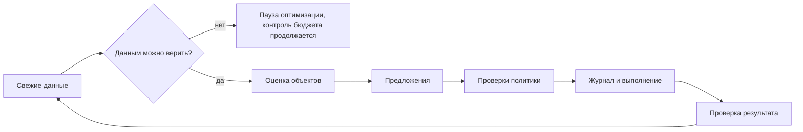
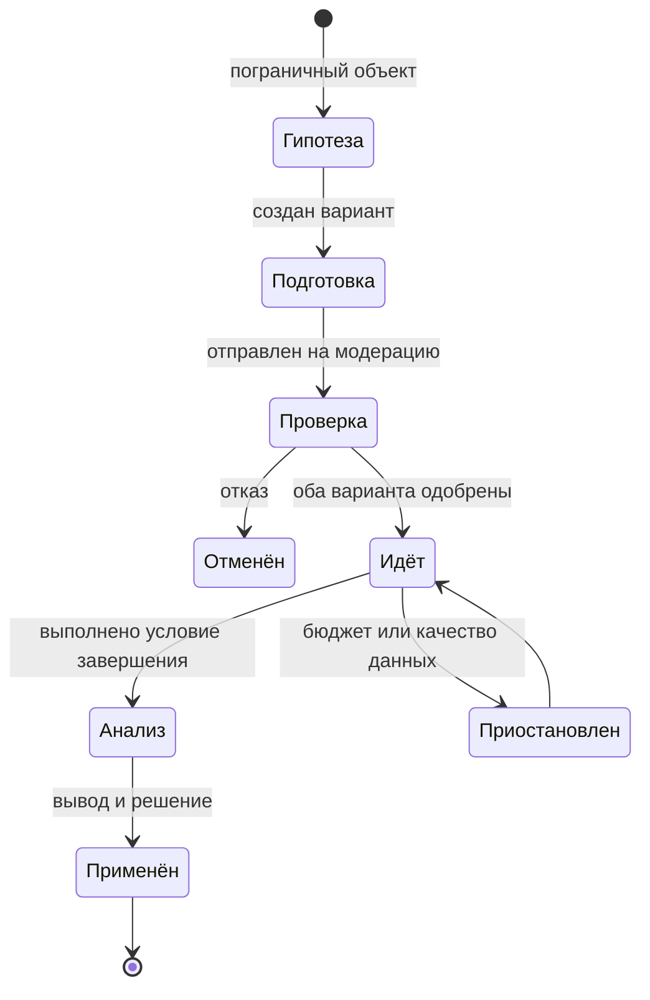

# Автопилот

Все числовые пороги ниже — стартовые значения. Они вынесены в версионируемый файл правил и калибруются на реальных кампаниях этапа 4. Версия правил записывается в каждое решение.

## 1. Рабочий цикл



**LLM не участвует в решениях о деньгах.** Модель только формулирует текст объявлений и объяснения, опираясь на посчитанные значения. Числа в объяснениях подставляются кодом и проверяются.

## 2. Страж бюджета

**Что гарантируем.** Расход за бюджетный период, по данным площадки, не превышает лимит пользователя.

**Почему этого нельзя достичь одной проверкой.** Статистика приходит с задержкой, площадка распределяет расход самостоятельно, наш сервис может упасть, а изменение лимита может создать всплеск. Поэтому используются независимые слои.

| Слой | Механизм | Что защищает |
|---|---|---|
| 1. План | Сумма лимитов не превышает рабочий бюджет `O = H × (1 − r)`; стартовый резерв `r = 10%` | Округления и неточность площадки |
| 2. Площадка | `CustomPeriodBudget` с датой окончания периода (`S2`) | Падение нашего сервиса, сбой API |
| 3. Контроль изменений | Проверка худшего случая перед любым изменением | Всплеск при смене параметров |
| 4. Наблюдение | `budget.watch` раз в 5 минут; период проверяется по `next_check_at`: обычно через 15 минут, у порога через 5. Остановка у порога | Неожиданный расход |
| 5. Перекрёстная проверка | Сверка с балансом кабинета; расхождение ведёт к остановке и тревоге | Ошибка в наших расчётах |
| 6. Запас на задержку | Порог учитывает скорость расхода и возраст данных | Запаздывание статистики |

### Проверка перед изменением

```text
spent        = расход за период по данным площадки, с поправкой на задержку
worst_active = сумма худших оставшихся расходов всех активных кампаний
worst_change = худший дополнительный расход от изменения
допустимо если: spent + worst_active + worst_change ≤ H
```

Проверка применяется к увеличениям. Снижение ей не блокируется, потому что уменьшает риск; нельзя только опустить лимит ниже уже потраченного. Поведение площадки при снижении подтвердит `S2`. `worst_change` не меньше самого прироста лимита. Сумма лимитов считается по всем кампаниям, включая приостановленные: их могут возобновить.

Пороги лежат в `src/adhelper/budget/adapters/rules/budget-1.toml`, доли заданы в базисных пунктах. Округление всегда в сторону безопасности: рабочий бюджет вниз, расход и прогноз вверх. Если новой статистики нет, скорость расхода сохраняется прежней, а не считается нулевой.

Для недельных лимитов при оплате за клики `worst_change` равен 35% старого + 35% нового лимита. **[Втор]** Стратегии с дневным расходом до 100% лимита запрещены политикой. Для лимитов периода коэффициент определяется опытом `S2`, а до этого применяется консервативная оценка.

Другие правила:
- Бюджет увеличиваем не чаще раза в неделю на кампанию и не более чем на 20–30% за шаг.
- Перенос бюджета выполняется в два шага: сначала снижение у донора, затем увеличение у получателя после подтверждения снижения.
- Откат проходит ту же проверку. Откат, который привёл бы к превышению, выполняется без роста бюджета с объяснением.

**Создание кампании** (`StoredPeriodPreflight._create`) нужен действующий период без незавершённой остановки. Срок кампании не выходит за конец периода. Сумма лимитов всех кампаний кабинета вместе с новой не больше рабочего бюджета. Считаются и приостановленные кампании, и созданные вне сервиса: их могут включить. Созданную кампанию откат не удаляет: её останавливает пауза, а объекты мы только приостанавливаем и архивируем.

### Порог остановки

```text
projected = spent + burn_rate × (возраст данных + интервал проверки + время остановки)
projected ≥ 0.97 × H  →  приостановить все кампании периода
projected ≥ 0.90 × H  →  проверять каждые 5 минут и предупредить
```

Если API недоступен, бюджет защищён слоем 2. Сервис сообщает об этом владельцу и повторяет остановку.

Лимит площадки по умолчанию не может быть выше `O`. Поэтому порог наблюдения срабатывает лишь при поломке слоя 2.

### Сверка со счётом

Слой 5: если со счёта ушло больше, чем показывает статистика, с допуском `balance_tolerance_bp` от лимита периода, кампании останавливаются и владелец получает тревогу. Пополнения сервису не видны, поэтому проверка односторонняя: пополнение может скрыть расхождение, но ложной тревоги не создаёт. Нулевой баланс не считается расхождением: кампании не трогаем, расход и так стоит, владелец получает просьбу пополнить счёт.

Как считается: при первом чтении баланса в периоде страж запоминает точку отсчёта, баланс и расход по статистике. Дальше `разница = (баланс в начале − баланс сейчас) − (расход сейчас − расход в начале)`. Допуск — `balance_tolerance_bp` от лимита периода, в `budget-1` это 2%. Если разница больше допуска, кампании периода останавливаются через журнал и появляется тревога `balance_mismatch`. Владелец подтверждает, что знает причину: точка отсчёта переносится на нынешний баланс и расход, тревога закрывается. Показы сами не включаются, это отдельное действие. Сценарий показа в [спецификации](01-product-spec.md), проверка в `tests/budget/test_period_and_balance.py` и `tests/api/test_cabinet.py`.

### Решения владельца: снятие паузы и смена бюджета

Оба действия идут единым путём: проверка → журнал `changes` со снимком «до» → исполнитель → чтение результата. Код: `budget/domain/owner.py`, `budget/application/owner.py`, маршруты `POST /resume` и `POST /budget` в `api/control.py`.

**Снятие паузы.** Кнопка снимает только паузу владельца: кампания включается, если последнее применённое включение или выключение её в журнале — пауза с источником `user`. Остановку стражем, нулевым балансом или расхождением со счётом кнопка не снимает. При открытой тревоге `budget_stopped`, `budget_stop_pending` или `balance_mismatch` сервис отказывает до записи в журнал. Перед включением каждой кампании исполнитель проверяет по свежему факту (`RESUME` в `StoredPeriodPreflight`):

```text
нет действующего периода или остановка в ожидании → отказ
период закончился → отказ
сумма лимитов всех кампаний > O → отказ
spent + Σ остатков лимитов активных кампаний и включаемой > H → отказ
```

Кампании включаются по одной, поэтому каждая следующая проверяется с учётом уже включённых. `spent` берётся по самому свежему снимку: площадка может вернуть статистику старше уже сохранённой. Включение можно отменить, отмена ставит паузу новой записью.

**Смена бюджета.** Новый бюджет `H'` не может быть ниже потраченного: минимум — наименьший `H'`, рабочая часть которого `O'` покрывает `max(spent, Σ spent кампаний)`; в отказе владелец видит это число. Если остатки лимитов не помещаются в `min(O' − Σ spent кампаний, H' − spent)`, остаток каждой кампании урезается пропорционально, не ниже её расхода. Снижения проходят через журнал и подтверждаются чтением, и только потом сохраняется новый бюджет. Если сервис остановится посередине, на площадке останутся лимиты не выше прежних при прежнем бюджете. Если Яндекс не подтвердил снижение, бюджет не меняется, а повтор начинается с чтения. Рост бюджета лимиты сразу не поднимает: это делает автопилот по обычным правилам роста. Свойства проверяются через `hypothesis` в `tests/budget/test_owner_budget.py`, сбои — в `tests/budget/test_owner_actions.py`.

### Решения владельца: район, часы показа и цель

**Район и часы** меняют площадку, поэтому идут тем же путём: проверка → журнал → исполнитель → чтение. Одна просьба ставит по записи `set_schedule` или `set_regions` на каждую кампанию бизнеса, цель записи — `targeting:<кампания>`, снимок «до» содержит прежние значения. Порядок такой: сначала все записи встают в очередь кабинета, потом исполнитель проходит их по порядку. Если Яндекс не ответил, очередь останавливается на первой несделанной записи и остальные ждут. Повтор того же запроса (`request_id`) начинается с чтения и второй записи не создаёт. Код: `campaigns/domain/targeting.py`, `campaigns/application/targeting.py`, `api/display.py`.

Проверки до журнала идут по файлу правил `targeting-1`:

```text
нет дней, часы вне 0–24 или начало не раньше конца → отказ
дней × часов < min_weekly_hours (8, порог Яндекса) → отказ
регионов нет или регион не из справочника → отказ
```

Каждое изменение отменяется из истории: отмена ставит прежнее значение новой записью. Бюджета эти изменения не касаются: лимиты стоят отдельно, сузить показ значит потратить не больше. После применения API записывает новое значение в витрину `campaigns.targeting` (`schedule_plan`, `region_ids` и слова для экрана). Пока синхронизации нет (T6), экран знает только то, что менялось через сервис, а иначе так и пишет.

**Дни без показа** («не показывай по воскресеньям» из чата) идут той же записью `set_schedule`, но у каждой кампании остаются её часы: из прочитанного `schedule_plan` убираются названные дни (`plan_skip`, `skip_days`, `POST /display/skip-days`). Сначала проверяются все кампании всех кабинетов, потом меняются: если хоть у одной останется меньше 8 часов в неделю, не меняется ничего. Кампанию без прочитанного расписания не трогаем и называем владельцу: часы не придумываем. Если расписание не прочитано ни у одной, просьба получает отказ.

**Цель** — желаемая цена обращения. Площадку она не трогает, поэтому в журнал не идёт и хранится в `lead_goals`. Это вход правил автопилота: каждое его решение записывает цель, с которой принято (`target_micros` во входных данных). Суточный цикл (`autopilot.run`, 06:20 МСК) идёт только для бизнесов с целью и в режиме `confirm`: сам он лишь предлагает тест владельцу. Источник статистики пока только демо и подставная площадка, поэтому на настоящих данных цикл не работал (T5, T6).

### Бюджетный период

Значение по умолчанию: 30 дней. Границы считаются от полуночи до полуночи по Москве и хранятся в UTC. После окончания периода увеличения запрещены, снижения разрешены. Новый период создаётся только после подтверждения итогов старого; неиспользованный остаток не переносится. Автопродление требует явного согласия при запуске. Расход сравнивается с лимитом на той же основе (с НДС или без), которую определит проверка `S3`. Кампании, созданные в кабинете вне сервиса, не входят в наш лимит, если их расход не включён явно: они показываются отдельной строкой с предупреждением.

## 3. Качество данных

Перед оценкой проверяем:
- Расход есть, а обращений необычно мало относительно истории.
- Метрика перестала получать визиты: код могли удалить.
- Клики Директа сильно расходятся с визитами Метрики.
- Площадка сообщила о сбое: включается флаг службы, а также ручной переключатель в настройках.

Плохое состояние переводит автопилот в режим «только защита»: разрешены остановки ради бюджета, запрещены выводы об эффективности. Октябрьский сбой 2026 года — обязательный сценарий теста: кабинет не работал, конверсии были разорваны, и система не должна была отключить хорошую рекламу из-за этого.

## 4. Оценка эффективности

### Какие данные используем

- Решения принимаем на «дозревших» данных: без последних 48 часов.
- Период обучения новых объектов: 7 дней или целевая цена × 2 расхода. До этого отключаем только при явных проблемах: отказ, сайт не работает.
- Объект: объявление, группа, кампания, площадка. Сначала оцениваем более крупный уровень, потом мелкий.

### Модель

У малого бизнеса мало обращений, а простое сравнение цен обманчиво. Поэтому оцениваем вероятность того, что цена обращения выше или ниже цели:

```text
обращения ~ Пуассон(λ · расход)
априорно: λ ~ Гамма(a, b), среднее = 1 / target_cpl, вес = 1 условное обращение
апостериорно: λ ~ Гамма(a + обращения, b + расход)
P_good = P(1/λ ≤ target_cpl)
P_bad  = P(1/λ ≥ 1.3 × target_cpl)
```

| Класс | Условие | Действие |
|---|---|---|
| Эффективно | `P_good ≥ 0.8` | Увеличить бюджет, если есть резерв и показы ограничены бюджетом |
| Неэффективно | `P_bad ≥ 0.9`, расход ≥ 2 × цели | Приостановить. Создать замену, если объектов мало |
| Пограничное | Расход ≥ цели, остальные условия не выполнены | Запустить A/B-тест |
| Мало данных | Расход ниже порога | Ждать, выделять минимально достаточный бюджет |

Если обращений совсем нет, но есть визиты, используем сигнал `micro`, но только для сравнения вариантов, а не для оценки цены обращения.

Сделаем поправку на подтверждённых клиентов, когда они есть: цель по клиенту пересчитываем через фактическую долю обращений, ставших клиентами.

### Действия и ограничения

| Действие | Ограничения |
|---|---|
| Приостановить объявление | В группе остаётся минимум одно рабочее |
| Приостановить группу или кампанию | Освобождённый бюджет переносится или возвращается в резерв |
| Увеличить бюджет | Проверка худшего случая, не более раза в неделю |
| Создать объявление | Хранитель мест пишет текст под свободное место направления и ставит его без владельца, если прошли проверки ([05 §8](05-creatives.md#8-автономный-цикл-объявлений)) |
| Минус-слова и фразы | Из отчёта поисковых запросов, с журналом |
| Корректировки времени и устройств | Только при явных отличиях и достаточном объёме |

Ограничитель частоты: на кампанию не более одного существенного изменения за цикл, не менее 3 дней между изменениями, чтобы не мешать обучению стратегии.

### Режимы

`auto` — действует сам и сообщает (по умолчанию, как требует задание). `confirm` — спрашивает перед действиями с деньгами. `pause` — только наблюдает.

### Что реализовано

Реализованы модель оценки, качество данных, ограничения, режимы, журнал решений и симулятор (`autopilot-1`, сценарии 1–3). Реализована приостановка объявления и увеличение лимита кампании.

**Суточный цикл (`autopilot-2`).** Воркер запускает цикл каждый день в 06:20 по Москве для каждого кабинета, у которого владелец задал цель. До калибровки на пилоте цикл идёт в режиме `confirm`. `autopilot-2` повторяет пороги `autopilot-1` и добавляет условия теста: срок 7 дней, лимит за срок должен покрыть не меньше 4 целевых цен обращения, после отказа объявление не предлагается 14 дней. Данные цикл берёт из витрины. Пока витрина не хранит группы и визиты, действуют подмены в безопасную сторону:
- каждое объявление считается своей группой, поэтому автопилот не приостанавливает объявления сам;
- признак «лимит упирается в бюджет» не читается, поэтому лимиты сам не повышает;
- визиты берутся из Метрики через порт `SiteVisits` за последние `health_recent_days` московских дней (`autopilot/application/visits.py`); без счётчика, без данных за окно или при сбое Метрики они неизвестны, и проверки качества по визитам пропускаются, а не считаются нулём. Ноль визитов при кликах даёт `tracking_lost`, малая доля — `visits_mismatch`: цикл записывает решение `untrusted` и ничего не предлагает. Пока источник визитов есть только у подставной площадки, на деле визиты неизвестны. Проверено: `tests/autopilot/test_visits.py`, `tests/worker/test_autopilot_run.py`.

Пограничное объявление ждёт вместе с плохими, если по направлению идёт тест или изменение было меньше 3 дней назад: журнал называет причину, а не пишет «без действия».

**Симулятор на истории.** `adhelper simulate --business <id> [--rules autopilot-1] [--against autopilot-2] [--target <₽>]` читает записанные дни кабинета (`ad_stats`) и текущие лимиты, прогоняет обе версии правил и печатает, в какие дни и по каким объектам решения разошлись. Только чтение: площадка и журнал не меняются. Цель берётся из кабинета, если её не задали в команде. Каждая версия идёт своим путём, поэтому видны и последствия первого расхождения. Те же подмены, что у суточного цикла: объявление — своя группа, визиты неизвестны. Объявление без строки в какой-то день считается не работавшим в этот день. Идущий тест длится `test_days`, его исход не моделируется. Новую версию правил выпускаем после прогона на истории: расхождения объясняем до выпуска. Вероятности считаются точно через сумму Пуассона и хранятся в базисных пунктах, округляются вниз и не достигают 100%. Дни, отмеченные как недостоверные, исключаются из оценки. Ещё не сделаны: уровни группы и кампании, создание замены, минус-слова, корректировки, `micro` и поправка на подтверждённых клиентов.

## 5. A/B-тесты

### Почему свой механизм

Эксперименты Директ Про не найдены в API. Создание сегментов через Аудитории закрыто. В одной группе ротация Директа сама смещает показы к лучшему по её мнению варианту, что искажает сравнение. Подробности в [исследовании](00-research.md#3-ab-эксперименты-директ-про).

### Типы

**Тест объявлений: чередование (switchback).** Одна кампания и одна аудитория. Варианты поочерёдно активны в сбалансированном по дням порядке, например `A B B A B A A B`.
- Плюсы: работает через публичный API и на малом бюджете, одинаковая аудитория, одинаковый аукцион, управление через `Ads.suspend` и `resume`.
- Минусы: влияние времени снижается балансировкой, но полностью не исчезает; возможен перенос эффекта обучения стратегии. На первые часы после смены действует исключающий интервал.
- `S7` проверяет, как приостановка влияет на обучение и модерацию. Если влияние вредно, переключаемся на запасной вариант.

**Тест аудиторий: параллельные группы.** Для сравнения разных аудиторий чередование не нужно: они сами разные. Группы получают один и тот же креатив, а анализ учитывает, что разделение бюджета не случайно. В выводе обязательно: «сравнение наблюдательное».

**Запасной вариант:** параллельные копии с равными лимитами в отдельных кампаниях. Менее чистый метод, используем при отрицательном результате `S7`.

### Ход теста



**Запуск** — по итогам анализа, а не по расписанию: тест нужен, когда суточный цикл признал объявление пограничным. Не более одного теста на кампанию и только если лимит за срок теста покрывает минимальный объём (`test_min_target_multiple` целевых цен обращения). Гипотезу код выбирает из закрытого списка по тому, что подтверждено профилем: цена — если у услуг есть цены, выгода — если есть особенности, призыв — всегда. Уже проверенные гипотезы для этого объявления пропускаются.

В режиме `confirm` цикл записывает предложение в журнал решений (`start_test`, `awaiting_confirmation`) с цифрами: расход, обращения, цель, лимит, гипотеза. «Сегодня» показывает его карточкой «Предлагаю проверить новый вариант объявления». Ответ владельца — новая запись в журнале, старая не меняется:
- «Проверить вариант» создаёт тест в статусе «Проверка» без варианта (`prepared`) или отвечает, что тест на направлении уже идёт;
- «Не сейчас» записывает отказ (`declined`), и объявление не предлагается на срок `test_decline_hold_days`;
- «Отменить тест» на готовящемся тесте отменяет его (`owner_cancelled`) и тоже записывает отказ.

Ответ принимается только на действующее предложение: повтор и старая карточка получают 409. В режиме `auto` цикл готовит тест сам. Предложение, ответ и отмена площадку не меняют. Готовящийся тест получает вариант в воркере (`experiments.run`): запись журнала `create_ad` с источником `experiment`, затем `pause_ad`, чтобы до старта показывался только контроль. Отмена владельцем возможна только до старта: тест получает статус «Отменён», а уже созданный вариант остаётся выключенным на площадке. Отмену идущего теста сервис не принимает (409): она переключала бы показы и пока не сделана. Всё это проверено только на подставной площадке, клиент Директа — T5.

**Гипотезы** выбирает код из закрытого списка: оффер, цена, выгода или результат, социальное доказательство, изображение, призыв. Ограничение — один параметр за тест. Сейчас предлагаются только цена (нужны цены в профиле), выгода (нужны особенности) и призыв; вариант пишет код из профиля (`experiments/domain/variant.py`). Оффер, отзывы и изображение не предлагаются: в профиле нет скидок, отзывов и картинок.

**Метрика:** обращения. Если за неделю обращений мало, основной метрикой становится `micro`-сигнал, а вывод это обязательно называет.

**Анализ:**

```text
По вариантам: успехи s, клики n
p ~ Бета(1 + s, 1 + n − s)
P(B лучше A) считается точной формулой для бета-распределений: выборка дала бы разные решения на одном входе
Также цена результата: расход ÷ успехи
```

Завершение при первом выполнении условий:
- `P(B лучше A) ≥ 0.9` или `≤ 0.1`, не менее 7 дней и минимум по кликам на вариант;
- максимальная длительность, стартово 21 день;
- максимальные траты на тест.

**Решение применяется всегда:**

| Результат | Решение | Пример объяснения |
|---|---|---|
| Победитель | Победитель активен, проигравший приостановлен | «С вероятностью 93% вариант с отзывами лучше» |
| Разницы не найдено | Оставляем дешевле по цене результата или простой вариант | «Разница мала, поэтому оставили вариант с меньшей ценой обращения» |
| Данных мало | Сохраняем контроль и новая гипотеза | «Данных мало, проверка не подтвердила улучшение. Оставили прежний вариант» |

Важно не завышать уверенность: промежуточные значения не показываются как окончательные выводы.

### Что реализовано в тестах

Статусы, расписание Морса, расчёт вероятности, условия завершения (`experiments-1`), один тест на кампанию, переключение через журнал: сначала включение, потом выключение. Сценарии 9 и 10 проверены на поддельной площадке. Запуск по итогам анализа, предложение владельцу, подготовка и отмена до начала реализованы (сценарий 27 в [07](07-testing-acceptance.md)). Ход теста до показов (2026-11-05, `experiments/application/pipeline.py`, задача воркера `experiments.run` раз в час): готовящийся тест получает вариант через журнал (`create_ad`, источник `experiment`, цель `newad:ahx-<id>`), и вариант сразу выключается (`pause_ad`), пока Яндекс его не проверит. Вариант собирает код из профиля (`experiments/domain/variant.py`): меняется один параметр по гипотезе (цена, преимущество, призыв), он проходит ту же проверку фактов, что и объявления хранителя, и не копирует контроль. Если такой вариант не собрать, тест честно отменяется с причиной `no_variant`. Одобренный вариант запускает чередование по дням, отклонённый отменяет тест, контроль продолжает работать. Статистику проход берёт из `ad_stats` с московского дня старта; открытая тревога `data_untrusted` делает данные недостоверными. Ответ, потерянный при создании, доводится чтением журнала, повтор ничего не задваивает. Исключающий интервал не подключён: см. [риски](06-delivery-plan.md#риски-работы-до-доступа-к-директу).

## 6. История и откат

### Что считается изменением

Любое действие на площадке: от автопилота, пользователя, A/B-теста, отката и изменений вне сервиса. Запись содержит снимки, причину, входные данные решения и версию правил.

### Как строится объяснение

1. Код формирует структуру фактов: `spent=1840, leads=0, target=400, days=12`.
2. Шаблон выдаёт надёжный текст. Модель необязательна для перефразирования, но после неё проверяем, что все числа совпадают с фактами; при ошибке остаётся шаблон.

### Откат

Откат создаёт новую запись-операцию, старая остаётся. Шаги:

1. Прочитать текущее состояние объекта и сравнить с `after` исходной записи.
2. Если объект изменён позже, показать это и предложить откат с учётом зависимых действий.
3. Пропустить целевое состояние через проверки политики.
4. Выполнить и подтвердить чтением.

| Тип изменения | Откат |
|---|---|
| Пауза и запуск | Обратное действие |
| Бюджет, стратегия, настройки | Возврат значения через проверку бюджета |
| Новое объявление | Приостановка и архивирование, без удаления |
| Правка объявления | Возврат полей, требуется модерация, предупреждаем |
| Минус-слова, фразы | Обратное изменение списка |
| Завершение теста | Включение прежнего варианта |
| Потраченные деньги и данные обучения | Нельзя вернуть, интерфейс говорит об этом честно |
| Завершённый бюджетный период | Откат недоступен, объяснение |

После отката объект получает защиту от автопилота на 14 дней, чтобы система не повторила отменённое пользователем действие.

### Что реализовано

`ledger/application/rollback.py`: откат создаёт новые записи журнала тем же путём. Зависимые изменения показываются и отменяются только по согласию, от новых к старым. Правка из кабинета не перезаписывается без согласия. Повышение при откате проходит проверку бюджета и может быть отклонено, например если лимит уже повышали меньше недели назад. Остановка кампании стражем откатом не снимается. Сценарий 8 проверен на поддельной площадке.

Последствия до нажатия (2026-11-03): `preview_rollback` проходит те же проверки, что и откат, но только читает площадку. `consequences.py` собирает текст из снимка «до» в журнале: какое значение вернётся, сколько направлений затронуто, что потраченные деньги не вернутся. Если отменить нельзя, владелец сразу видит причину, а кнопки отмены нет.

Отмена просьбы целиком: просьба владельца, разошедшаяся по направлениям, узнаётся по ключу «вид:запрос:направление» (`schedule:`, `regions:`, `owner:`, `owner-resume:`). Изменения автопилота не группируются: каждое из них отдельное решение. Сначала проверяются все направления, и если хоть одно отменить нельзя, не меняется ни одно. Уже отменённые части пропускаются. Затем каждое направление отменяется своей записью, от нового к старому. История помечает отменённые записи и больше не предлагает их отменить.
