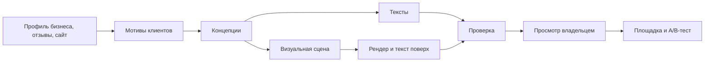

# Креативы

Цель: реклама с высокой конверсией, а не шаблонный ИИ-контент. Сравнивать нужно на реальных результатах: вариант живёт только при подтверждении A/B-тестом.

## 1. Главная идея

**Сначала мысль, потом картинка.** Сервис не просит модель «нарисовать красивый маникюр». Он находит конкретную причину, почему человек выберет этот бизнес, и лишь потом подбирает форму.

## 2. Концепции

Система формирует 5–8 концепций, выбирает 3 разных по направлению и показывает владельцу на понятном языке.

| Направление | Маникюр | Йога |
|---|---|---|
| Конкретная боль | «Покрытие продержится весь отпуск, без сколов на третий день» | «Спина перестанет напоминать о себе к пятнице» |
| Снятие страха | «Стерильные инструменты: крафт-пакет вскрываем при вас» | «Первый раз? 60% группы тоже не сядет в шпагат» |
| Близость | «5 минут от метро: успеете до работы» | «Утренняя практика в вашем районе, 7:30» |
| Доказательство | «Мастер, к которому записываются на месяц вперёд» | Реальный отзыв и имя с согласия |
| Необычный ход | Хронометраж процедуры, «45 минут тишины» | «Записаться с подругой — вторая бесплатно» |

Числа и утверждения из примеров иллюстрируют подход. В настоящей рекламе используются только факты из профиля: **система не выдумывает** скидки, цены, отзывы и достижения.

## 3. Изображения

**Реальные фото — приоритет.** Настоящие работы и интерьер отвечают главному вопросу клиента. Генерация особенно слаба на руках и пальцах, а для маникюра это критично. Поэтому:

1. **Фото владельца:** автокадрирование, улучшение, наложение оффера.
2. **Сгенерированные сцены:** где реальность не нужна, например настроение, предмет, метафора. Руки и лица крупным планом для ногтевого сервиса не генерируем.
3. **Типографические креативы:** крупная фраза на цветном фоне. Дёшево и часто выделяется среди однотипных фото.

**Текст никогда не генерируется внутри картинки.** Он накладывается нашим рендером: HTML-шаблоны, шрифты с лицензией, контроль контраста.

**Форматы:** 1:1, 16:9, 4:5, 9:16; минимум 450 px по стороне, рендер 1080 px и выше; файлы в пределах ограничений площадки. Обязательные поля перед отправкой проверяются автоматически.

## 4. Видео

Видео собирается программно: FFmpeg и шаблоны на HTML. Длительность 6–15 секунд, 9:16 и 1:1, 1080p, H.264 + AAC стерео 44 кГц. Загрузка проверяется в `S6`.

Сценарии:
- **Текстовая история:** 3–4 кадра с короткими фразами и реальными фото.
- **До и после:** только реальные материалы.
- **Один факт:** крупная типографика с анимацией.
- **AI-сцена (необязательно):** подключается только после сравнения качества.

Без звука смысл должен оставаться понятным. Музыка только с лицензией, допускающей рекламу.

## 5. Проверки перед отправкой

| Проверка | Как |
|---|---|
| Длины и символы | Код, по лимитам площадки, учитывая узкие символы |
| Факты | Каждая цифра и утверждение привязаны к полю профиля |
| Запрещённые формулировки | Правила: превосходные степени без подтверждения, гарантия результата, медицинские обещания |
| Иностранные слова | Словарь и исключения для товарных знаков |
| Чувствительные ниши | Косметология и медицина требуют отдельной проверки; вне поддерживаемых ниш запуск только с подтверждением |
| Качество изображения | Модель машинного зрения и простые метрики: дефекты, читаемость текста, контраст |
| Похожесть | Не показывать почти одинаковые варианты в одном тесте |
| Согласия | Фото с людьми и отзывы: подтверждение от владельца |

Правила согласуются с юристом заказчика или, при отсутствии, помечаются как автоматическая проверка без юридической гарантии. Окончательную проверку выполняет модерация площадки.

## 6. Оценка качества

Внутренний набор: 10 профилей бизнесов и контрольный список. Новая версия подсказок не выпускается, если ухудшает оценку.

1. **Перед запуском:** эксперт или слепая оценка людьми с вопросом «на что вы бы кликнули?».
2. **После запуска:** CTR, доля обращений, результат A/B-тестов. Итоги выигравших концепций накапливаются анонимно и повышают приоритет похожих направлений в той же нише.

Стоимость каждого набора креативов учитывается и ограничивается лимитом.
