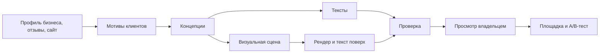

# Креативы

Цель: реклама с высокой конверсией, а не шаблонный ИИ-контент. Сравнивать нужно на реальных результатах: вариант живёт только при подтверждении A/B-тестом.

## 1. Главная идея

**Сначала мысль, потом картинка.** Сервис не просит модель «нарисовать красивый маникюр». Он находит конкретную причину, почему человек выберет этот бизнес, и лишь потом подбирает форму.

## 2. Концепции

Система формирует 5–8 концепций, выбирает 3 разных по направлению и показывает владельцу на понятном языке.

| Направление | Маникюр | Йога |
|---|---|---|
| Конкретная боль | «Покрытие продержится весь отпуск, без сколов на третий день» | «Спина перестанет напоминать о себе к пятнице» |
| Снятие страха | «Стерильные инструменты: крафт-пакет вскрываем при вас» | «Первый раз? 60% группы тоже не сядет в шпагат» |
| Близость | «5 минут от метро: успеете до работы» | «Утренняя практика в вашем районе, 7:30» |
| Доказательство | «Мастер, к которому записываются на месяц вперёд» | Реальный отзыв и имя с согласия |
| Необычный ход | Хронометраж процедуры, «45 минут тишины» | «Записаться с подругой — вторая бесплатно» |

Числа и утверждения из примеров иллюстрируют подход. В настоящей рекламе используются только факты из профиля: **система не выдумывает** скидки, цены, отзывы и достижения.

## 3. Изображения

**Реальные фото — приоритет.** Настоящие работы и интерьер отвечают главному вопросу клиента. Генерация особенно слаба на руках и пальцах, а для маникюра это критично. Поэтому:

1. **Фото владельца:** автокадрирование, улучшение, наложение оффера.
2. **Сгенерированные сцены:** где реальность не нужна, например настроение, предмет, метафора. Руки и лица крупным планом для ногтевого сервиса не генерируем.
3. **Типографические креативы:** крупная фраза на цветном фоне. Дёшево и часто выделяется среди однотипных фото.

**Текст никогда не генерируется внутри картинки.** Он накладывается нашим рендером: HTML-шаблоны, шрифты с лицензией, контроль контраста.

**Форматы:** 1:1, 16:9, 4:5, 9:16; минимум 450 px по стороне, рендер 1080 px и выше; файлы в пределах ограничений площадки. Обязательные поля перед отправкой проверяются автоматически.

## 4. Видео

Видео собирается программно: FFmpeg и шаблоны на HTML. Длительность 6–15 секунд, 9:16 и 1:1, 1080p, H.264 + AAC стерео 44 кГц. Загрузка проверяется в `S6`.

Сценарии:
- **Текстовая история:** 3–4 кадра с короткими фразами и реальными фото.
- **До и после:** только реальные материалы.
- **Один факт:** крупная типографика с анимацией.
- **AI-сцена (необязательно):** подключается только после сравнения качества.

Без звука смысл должен оставаться понятным. Музыка только с лицензией, допускающей рекламу.

## 5. Проверки перед отправкой

| Проверка | Как |
|---|---|
| Длины и символы | Код, по лимитам площадки, учитывая узкие символы |
| Факты | Каждая цифра и утверждение привязаны к полю профиля |
| Запрещённые формулировки | Правила: превосходные степени без подтверждения, гарантия результата, медицинские обещания |
| Иностранные слова | Словарь и исключения для товарных знаков |
| Чувствительные ниши | Косметология и медицина требуют отдельной проверки; вне поддерживаемых ниш запуск только с подтверждением |
| Качество изображения | Модель машинного зрения и простые метрики: дефекты, читаемость текста, контраст |
| Похожесть | Не показывать почти одинаковые варианты в одном тесте |
| Согласия | Фото с людьми и отзывы: подтверждение от владельца |

Правила согласуются с юристом заказчика или, при отсутствии, помечаются как автоматическая проверка без юридической гарантии. Окончательную проверку выполняет модерация площадки.

## 6. Оценка качества

Внутренний набор: 10 профилей бизнесов и контрольный список. Новая версия подсказок не выпускается, если ухудшает оценку.

1. **Перед запуском:** эксперт или слепая оценка людьми с вопросом «на что вы бы кликнули?».
2. **После запуска:** CTR, доля обращений, результат A/B-тестов. Итоги выигравших концепций накапливаются анонимно и повышают приоритет похожих направлений в той же нише.

Стоимость каждого набора креативов учитывается и ограничивается лимитом.

## 7. Что реализовано

Порт `TextModel`, один клиент OpenAI-совместимого API для любого провайдера (адрес, ключ, модель в конфигурации), запасные шаблоны из профиля. Проверки из §5: длины и узкие символы, числа и обещания по профилю, запрещённые слова (`creatives-1`), иностранные слова, похожесть, отметка чувствительной ниши. Типографические карточки через Pillow во всех форматах §3, шрифт Roboto (Apache 2.0), контроль контраста; текст не помещается — карточка не создаётся, обрезки нет. Решение: вместо HTML-шаблонов пока Pillow, потому что типографике хватает его и не нужен браузер в образе.

**Судья смысла.** Над детерминированной проверкой стоит необязательный судья (`domain/judge.py`). Код делит объявление на фрагменты (заголовок и каждое предложение), модель помечает каждый фрагмент `confirmed`, `unconfirmed` или `not_a_claim`; фрагмент без оценки считается неподтверждённым. Решение принимает код, а не модель: если есть хотя бы одно `unconfirmed`, объявление снимается. Судья видит только то, что прошло код, и может лишь снять его — одобрить то, что код отклонил, он не может. Сбой, непонятный ответ или нехватка токенов — тоже снятие (fail-closed). Профиль и объявление передаются как данные; указания внутри не выполняются. Модель задаётся `JUDGE_MODEL_NAME`, пустое значение выключает судью. Проверено пробным вызовом `qwen/qwen3-30b-a3b-instruct-2507` через OpenRouter 2026-11-01: судья снял «Записываемся на месяц вперёд» и «лучшие мастера», которые код пропускал.

**Набор оценки проверки фактов** (`evals/`, запуск `uv run python -m evals.run judge|generate|code`). 113 размеченных объявлений на 9 профилях: 36 чистых, 73 с нарушением (выдуманные качества, отзывы, удобства, сроки, обещания результата, потерянные условия, превосходные степени, указания проверяющему в профиле и в тексте), 4 спорных не считаются. Части: `dev` — для улучшений, `holdout` — для проверки, `fresh` — 33 примера, размеченные до первого прогона. Вариант судьи попадает в сервис, только если выигрывает на `holdout` и `fresh`. Замер 2026-11-01, `qwen/qwen3-30b-a3b-instruct-2507`, три повтора, решение большинством вместе с кодом:

| Вариант | holdout + fresh: поймано | зря снято чистых |
|---|---|---|
| Только код (`creatives-2`) | 13 из 49 | 0 из 22 |
| v1: модель сама делит на утверждения | 42 из 49 | 1 из 22 |
| v3: делит код, список видов утверждений (в сервисе) | 48 из 49 | 0 из 22 |

Другие модели с v1: `qwen3-235b` не лучше 30b и нестабилен на указаниях в тексте, `mistral-small-3.2` слабее (82%).

**Генерация на реальной модели**, тот же день, 9 профилей по 2 попытки. Схема ответа раньше не доходила до модели, и все 36 попыток уходили в шаблоны; исправлено в клиенте. После исправления и целевой длины с запасом модель дала набор в 15 случаях из 18, объявлений 31. Код снял 41 черновик (36 — длина), судья 43. Ручной разбор 31 оставшегося: одна выдумка («Независимо от времени суток…» при профиле «Выезд в течение 2 часов») прошла оба слоя дважды, ещё в 6 есть оценочные слова без опоры на профиль («уютной зоне», «Комфортно и чисто»).

**Генерация в сервисе.** Владелец заполняет профиль на экране «О бизнесе» и просит набор на экране «Объявления». Запрос пишет строку `creative_sets` со статусом `queued`, и эта строка служит заданием. Воркер раз в минуту выполняет `creatives.generate` в очереди `creatives`: берёт наборы через `FOR UPDATE SKIP LOCKED` и выполняет генерацию, проверки `creatives-2` и судью. Результат пишется в ту же строку. Набор, зависший в `running` дольше 15 минут, берётся повторно; после двух попыток он помечается `failed`. В лог попадает только тип ошибки. За скользящие сутки можно попросить не больше `max_sets_per_day` наборов. Каждый черновик владелец одобряет или отклоняет. Одобрение пока только записывается: в Директ ничего не уходит до T6. Проверено: `tests/creatives/test_service.py` на настоящем PostgreSQL и поддельной модели. Прогон через рабочее окружение воркера 2026-11-01, `qwen3-30b-instruct`: 19 с, 2 563 токена, 2 черновика прошли, 3 сняты по длине. В одном прошедшем есть «с соблюдением всех санитарных норм» без опоры на профиль: судья это не снял, проверка владельцем нужна.

Не реализовано: концепции и мотивы, фото владельца, `ImageModel`, видео, проверка качества изображений, согласия. Судья уменьшает, но не снимает риск смысла: на наборе он пропускает около 2% нарушений, а на сгенерированных объявлениях пропустил выдуманный график. Проверка владельцем остаётся, см. [риски](06-delivery-plan.md#риски-работы-до-доступа-к-директу).
