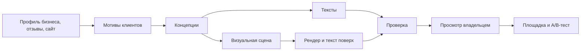
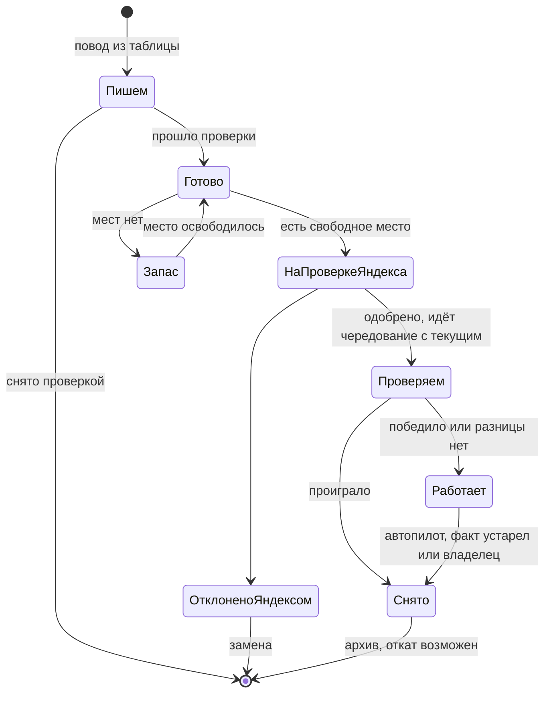

# Креативы

Цель: реклама с высокой конверсией, а не шаблонный ИИ-контент. Сравнивать нужно на реальных результатах: вариант живёт только при подтверждении A/B-тестом.

## 1. Главная идея

**Сначала мысль, потом картинка.** Сервис не просит модель «нарисовать красивый маникюр». Он находит конкретную причину, почему человек выберет этот бизнес, и лишь потом подбирает форму.

## 2. Концепции

Система формирует 5–8 концепций, выбирает 3 разных по направлению и показывает владельцу на понятном языке.

| Направление | Маникюр | Йога |
|---|---|---|
| Конкретная боль | «Покрытие продержится весь отпуск, без сколов на третий день» | «Спина перестанет напоминать о себе к пятнице» |
| Снятие страха | «Стерильные инструменты: крафт-пакет вскрываем при вас» | «Первый раз? 60% группы тоже не сядет в шпагат» |
| Близость | «5 минут от метро: успеете до работы» | «Утренняя практика в вашем районе, 7:30» |
| Доказательство | «Мастер, к которому записываются на месяц вперёд» | Реальный отзыв и имя с согласия |
| Необычный ход | Хронометраж процедуры, «45 минут тишины» | «Записаться с подругой — вторая бесплатно» |

Числа и утверждения из примеров иллюстрируют подход. В настоящей рекламе используются только факты из профиля: **система не выдумывает** скидки, цены, отзывы и достижения.

## 3. Изображения

**Реальные фото — приоритет.** Настоящие работы и интерьер отвечают главному вопросу клиента. Генерация особенно слаба на руках и пальцах, а для маникюра это критично. Поэтому:

1. **Фото владельца:** автокадрирование, улучшение, наложение оффера.
2. **Сгенерированные сцены:** где реальность не нужна, например настроение, предмет, метафора. Руки и лица крупным планом для ногтевого сервиса не генерируем.
3. **Типографические креативы:** крупная фраза на цветном фоне. Дёшево и часто выделяется среди однотипных фото.

**Текст никогда не генерируется внутри картинки.** Он накладывается нашим рендером: HTML-шаблоны, шрифты с лицензией, контроль контраста.

**Форматы:** 1:1, 16:9, 4:5, 9:16; минимум 450 px по стороне, рендер 1080 px и выше; файлы в пределах ограничений площадки. Обязательные поля перед отправкой проверяются автоматически.

## 4. Видео

Видео собирается программно: FFmpeg и шаблоны на HTML. Длительность 6–15 секунд, 9:16 и 1:1, 1080p, H.264 + AAC стерео 44 кГц. Загрузка проверяется в `S6`.

Сценарии:
- **Текстовая история:** 3–4 кадра с короткими фразами и реальными фото.
- **До и после:** только реальные материалы.
- **Один факт:** крупная типографика с анимацией.
- **AI-сцена (необязательно):** подключается только после сравнения качества.

Без звука смысл должен оставаться понятным. Музыка только с лицензией, допускающей рекламу.

## 5. Проверки перед отправкой

| Проверка | Как |
|---|---|
| Длины и символы | Код, по лимитам площадки, учитывая узкие символы |
| Факты | Каждая цифра и утверждение привязаны к полю профиля |
| Запрещённые формулировки | Правила: превосходные степени без подтверждения, гарантия результата, медицинские обещания |
| Иностранные слова | Словарь и исключения для товарных знаков |
| Чувствительные ниши | Косметология и медицина требуют отдельной проверки; вне поддерживаемых ниш запуск только с подтверждением |
| Качество изображения | Модель машинного зрения и простые метрики: дефекты, читаемость текста, контраст |
| Похожесть | Не показывать почти одинаковые варианты в одном тесте |
| Согласия | Фото с людьми и отзывы: подтверждение от владельца |

Правила согласуются с юристом заказчика или, при отсутствии, помечаются как автоматическая проверка без юридической гарантии. Окончательную проверку выполняет модерация площадки.

## 6. Оценка качества

Внутренний набор: 10 профилей бизнесов и контрольный список. Новая версия подсказок не выпускается, если ухудшает оценку.

1. **Перед запуском:** эксперт или слепая оценка людьми с вопросом «на что вы бы кликнули?».
2. **После запуска:** CTR, доля обращений, результат A/B-тестов. Итоги выигравших концепций накапливаются анонимно и повышают приоритет похожих направлений в той же нише.

Стоимость каждого набора креативов учитывается и ограничивается лимитом.

## 7. Что реализовано

Порт `TextModel`, один клиент OpenAI-совместимого API для любого провайдера (адрес, ключ, модель в конфигурации), запасные шаблоны из профиля. Проверки из §5: длины и узкие символы, числа и обещания по профилю, запрещённые слова (`creatives-1`), иностранные слова, похожесть, отметка чувствительной ниши. Типографические карточки через Pillow во всех форматах §3, шрифт Roboto (Apache 2.0), контроль контраста; текст не помещается — карточка не создаётся, обрезки нет. Решение: вместо HTML-шаблонов пока Pillow, потому что типографике хватает его и не нужен браузер в образе.

**Судья смысла.** Над детерминированной проверкой стоит необязательный судья (`domain/judge.py`). Код делит объявление на фрагменты (заголовок и каждое предложение), модель помечает каждый фрагмент `confirmed`, `unconfirmed` или `not_a_claim`; фрагмент без оценки считается неподтверждённым. Решение принимает код, а не модель: если есть хотя бы одно `unconfirmed`, объявление снимается. Судья видит только то, что прошло код, и может лишь снять его — одобрить то, что код отклонил, он не может. Сбой, непонятный ответ или нехватка токенов — тоже снятие (fail-closed). Профиль и объявление передаются как данные; указания внутри не выполняются. Модель задаётся `JUDGE_MODEL_NAME`, пустое значение выключает судью. Проверено пробным вызовом `qwen/qwen3-30b-a3b-instruct-2507` через OpenRouter 2026-11-01: судья снял «Записываемся на месяц вперёд» и «лучшие мастера», которые код пропускал.

**Набор оценки проверки фактов** (`evals/`, запуск `uv run python -m evals.run judge|generate|code`). 113 размеченных объявлений на 9 профилях: 36 чистых, 73 с нарушением (выдуманные качества, отзывы, удобства, сроки, обещания результата, потерянные условия, превосходные степени, указания проверяющему в профиле и в тексте), 4 спорных не считаются. Части: `dev` — для улучшений, `holdout` — для проверки, `fresh` — 33 примера, размеченные до первого прогона. Вариант судьи попадает в сервис, только если выигрывает на `holdout` и `fresh`. Замер 2026-11-01, `qwen/qwen3-30b-a3b-instruct-2507`, три повтора, решение большинством вместе с кодом:

| Вариант | holdout + fresh: поймано | зря снято чистых |
|---|---|---|
| Только код (`creatives-2`) | 13 из 49 | 0 из 22 |
| v1: модель сама делит на утверждения | 42 из 49 | 1 из 22 |
| v3: делит код, список видов утверждений (в сервисе) | 48 из 49 | 0 из 22 |

Другие модели с v1: `qwen3-235b` не лучше 30b и нестабилен на указаниях в тексте, `mistral-small-3.2` слабее (82%).

**Генерация на реальной модели**, тот же день, 9 профилей по 2 попытки. Схема ответа раньше не доходила до модели, и все 36 попыток уходили в шаблоны; исправлено в клиенте. После исправления и целевой длины с запасом модель дала набор в 15 случаях из 18, объявлений 31. Код снял 41 черновик (36 — длина), судья 43. Ручной разбор 31 оставшегося: одна выдумка («Независимо от времени суток…» при профиле «Выезд в течение 2 часов») прошла оба слоя дважды, ещё в 6 есть оценочные слова без опоры на профиль («уютной зоне», «Комфортно и чисто»).

**Генерация в сервисе.** Набор заказывает не владелец, а хранитель мест (§8): строка `creative_sets` со статусом `queued`, направлением, поводом и числом нужных текстов служит заданием. Воркер раз в минуту выполняет `creatives.generate` в очереди `creatives`: берёт наборы через `FOR UPDATE SKIP LOCKED`, пишет тексты с темой направления, проверяет `creatives-2` и судьёй. Прошедшие тексты в той же транзакции становятся строками `creatives` в состоянии `ready` с источниками фактов. Набор, зависший в `running` дольше 15 минут, берётся повторно; после двух попыток он помечается `failed`. В лог попадает только тип ошибки. За скользящие сутки бизнес получает не больше `max_sets_per_day` наборов. Проверено: `tests/creatives/test_service.py` на настоящем PostgreSQL и поддельной модели. Прогон через рабочее окружение воркера 2026-11-01, `qwen3-30b-instruct`: 19 с, 2 563 токена, 2 черновика прошли, 3 сняты по длине. В одном прошедшем есть «с соблюдением всех санитарных норм» без опоры на профиль: судья это не снял.

Не реализовано: концепции и мотивы, фото владельца, `ImageModel`, видео, проверка качества изображений, согласия. Судья уменьшает, но не снимает риск смысла: на наборе он пропускает около 2% нарушений, а на сгенерированных объявлениях пропустил выдуманный график. Остаточный риск закрывают ворота запуска и снятие одним нажатием (§8), см. [риски](06-delivery-plan.md#риски-работы-до-доступа-к-директу).

## 8. Автономный цикл объявлений

Решение владельца проекта (2026-11-01): с объявлениями система работает сама, человек нужен примерно в 1% случаев. Кнопок «Сделать объявления» и «Одобрить» нет. Владелец видит, что работает и почему, и может снять любое объявление; согласие перед запуском не требуется. Реальный запуск ждёт адаптер Директа (T6) и проверку `S7`. Что уже сделано, см. в конце раздела.

**Объявление пишется под место, а не в общий список.** У каждого направления `slots_per_campaign = 3` места разных подходов (цена, удобство, доверие); место претендента для проверки добавит T7. Новое объявление всегда пишется для конкретного места. Прошедшие проверки, но не занявшие место, лежат в запасе направления (не больше `reserve_max = 2`) и снимаются при изменении профиля.

**Когда пишем.** Решает код по правилам `ads-1`, модель только пишет текст:

| Повод | Что делает система |
|---|---|
| Новое направление | Пишет 3 объявления разных подходов |
| Яндекс отклонил объявление | Берёт замену из запаса или пишет новую с учётом причины отказа |
| Объявление проиграло проверку или автопилот снял его за отсутствие обращений | Ставит на освободившееся место претендента |
| Владелец изменил цену, услугу, адрес или особенность | Сразу снимает объявления с этим фактом через журнал и ставит замену. Неверная цена в рекламе хуже паузы |
| В направлении нет идущей проверки, бюджета хватает на минимальный объём | Пишет претендента по одной гипотезе из [автопилота §5](04-autopilot.md#5-ab-тесты) |

Ограничения: лимит наборов и токенов за сутки, не больше одного нового объявления на направление за цикл.

**Ворота запуска без человека.** Объявление уходит само, если прошло код (`creatives-2`), судью и проверку похожести на работающие (`similarity_max_bp`). Шаблоны, собранные кодом из профиля, судья не проверяет. Текст модели, который судья не видел (судья выключен или недоступен), занимает место, но ждёт владельца. Новое объявление сначала идёт претендентом: оно получает лишь часть показов в чередовании, а не заменяет проверенное. Последняя проверка — модерация Яндекса. Остаточный риск пропуска выдумки (около 2% на наборе §7) закрывает возможность владельца снять объявление одним нажатием и сводка «что запущено».

**Жизненный цикл.** Каждый переход идёт через журнал: политика, снимок «до», исполнитель, чтение результата.

**Когда нужен человек.** Система пишет владельцу одно сообщение с причиной и кнопкой:
- чувствительная ниша (`sensitive_niches`): новые объявления ждут подтверждения;
- в профиле нет услуг, и писать не о чем;
- Яндекс дважды подряд отклонил объявления направления по одной причине: скорее всего, дело в сайте или профиле;
- отзыв или фото с человеком без подтверждённого согласия;
- генерация не идёт дольше часа: это тревога оператору, а не владельцу.

**Экран «Объявления».** Отвечает на вопрос «какие объявления сейчас работают и как». Группы: «Работают», «Проверяем», «Готовим», свёрнутые «Сняты». У карточки есть вид в поиске, состояние простыми словами, обращения и цена обращения за период. Карточка открывает отчёт объявления, где показаны:
- вид в поиске;
- **кому показываем:** направление, регион, поисковые фразы, время показа (из настроек кампании, их заполнит T6);
- **откуда факты:** каждая цена и утверждение со ссылкой на поле профиля, например «1 500 ₽ — услуга „Маникюр с покрытием“»;
- **история:** написано, запущено, проверено Яндексом, итог проверки против другого варианта;
- кнопка «Снять» через журнал с отменой.

Слова «модель», «судья», «правила creatives-2» владельцу не показываются. Вместо них одна фраза: «Все факты — из вашего профиля», и список источников.

**Что реализовано (2026-11-01).** Хранитель `ads.keep` раз в 5 минут для каждого бизнеса с направлениями строит план (`domain/lifecycle.py`, правила `ads-1`): снимает ожидающие объявления с устаревшим фактом (`fact_changed`) и почти повторяющие работающие (`too_similar`), ставит готовые на свободные места, лишние кладёт в запас, заказывает тексты под оставшиеся места. Повод заказа — `new_campaign`, `fact_changed` или `refill`. На одно направление пишется один набор за раз. Устаревшим считается объявление, где есть число не из профиля или где пропало поле профиля, на которое оно опиралось. Состояния объявления: `ready`, `reserve`, `launch_pending`, `needs_owner`, `stopped`, `withdrawn`. Ожидающие объявления ещё не на площадке, поэтому их переходы пишутся в историю строки `creatives`, а не в журнал `changes`; журнал начнётся с отправки в Директ (T6). Тревоги владельцу: `ads_no_profile` и `ads_need_confirmation`, обе закрываются сами. Оператору: `adhelper check` предупреждает о наборах, которые ждут дольше часа.

Экран «Объявления» готов: строка «что происходит сейчас», группы «Нужно ваше решение», «Работают», «Готовим», свёрнутые «Сняты». Отчёт объявления `#creative/<id>` показывает состояние с причиной и тем, что дальше, «Кому показываем» (`campaigns.targeting`), «Откуда факты» и историю. Отчёт работающего объявления показывает то же; число не из профиля там помечается. Кнопки «Запустить» (только для `needs_owner`) и «Не запускать» действуют до отправки в Директ. Снять работающее объявление можно будет после T6.

Не реализовано: отправка `launch_pending` в Директ, модерация и замена отклонённого, претендент и чередование (T6, T7), повод «проиграло проверку», снятие работающего объявления через журнал, сводка «что запущено» в письме.
