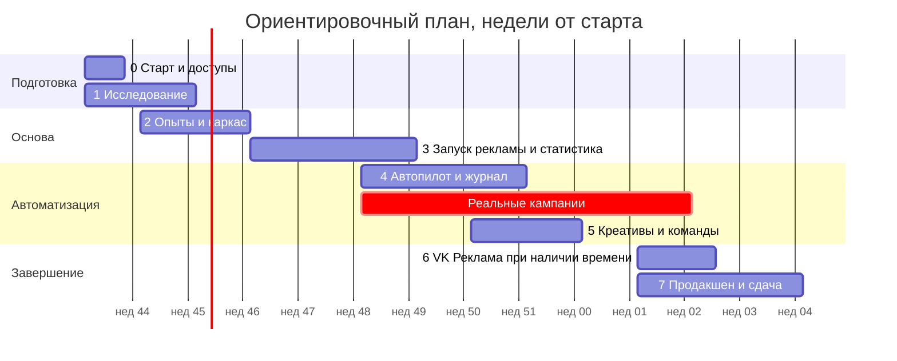

# План работ

Срок сдачи в задании не указан, его нужно согласовать с автором. Ниже реалистичная оценка для одного исполнителя: **около 12–14 недель**, из них не менее 4 недель реальных кампаний работают параллельно с разработкой. Сжать это время почти невозможно: системе нужны реальные данные, чтобы показать отключение, рост бюджета и A/B-тест.

Даты условные, старт предполагается 2 ноября 2026 года. Январские праздники могут сдвинуть работу и проверку заявок.

## Этап 0. Старт (первая неделя, параллельно)

Этот этап нельзя откладывать из-за внешних сроков.

- [ ] Подать заявку на полный доступ к Директ API. Перед этим создать кампанию в Директ Про.
- [ ] Согласовать с автором дату, бюджет на тесты и оплату интервью. [Вопросы](09-interviews.md#1-автор-задания)
- [ ] Выбрать реальный бизнес для пилота: свой или знакомого. Подтвердить, что есть сайт.
- [ ] Определить тестовый рекламный бюджет. Кабинет ведётся на настоящие деньги.
- [ ] Создать репозиторий, CI и каркас.
- [ ] Подать заявку на доступ к VK Рекламе.

**Готово, когда:** заявки поданы, вопросы автору отправлены, есть подтверждённый пилот и бюджет.

## Этап 1. Исследование (2 недели)

- Интервью с автором: приоритеты и спорные решения.
- 3–5 интервью с владельцами, 2–3 со специалистами. [Гайды](09-interviews.md)
- Разбор действующих кампаний в нишах и профильное обучение Яндекса. Цены кликов и обращений по нишам в разных городах.
- Прототип мастера настройки, проверка на двух владельцах.

**Результат:** обновлённые исследование и спецификация, пороговые значения бюджетов, проверенный прототип.

**Готово, когда:** ключевые гипотезы из спецификации подтверждены или заменены; автор ответил на вопросы, блокирующие проект.

## Этап 2. Опыты и каркас (2 недели)

- Закрыть проверки `S1`–`S5`, `S7`, `S8`, `S10`, `S11` на маленьких реальных кампаниях. Результаты занести в исследование.
- Вход через Яндекс, подключение кабинета, шифрование токенов.
- Клиент Директа: баллы, ошибки, журнал. Тесты на записанных ответах и песочнице.
- Модель данных, задачи, базовый интерфейс, Docker Compose, CI с тестами и линтерами.
- Первый выпуск на сервер.

**Готово, когда:** можно зайти, подключить кабинет на проде и увидеть кампании и баланс. Закрытие `S2` и `S3` даёт окончательную конструкцию контроля бюджета.

**Точка решения:** если `CustomPeriodBudget` не подходит, переходим на недельные лимиты с более строгим наблюдением и пересматриваем [стража бюджета](04-autopilot.md#2-страж-бюджета).

## Этап 3. Запуск рекламы и статистика (3 недели)

- Мастер: бизнес, разбор сайта, маркировка, Метрика и проверка кода, бюджет.
- Журнал и исполнитель в базовом виде: все изменения сразу идут через него.
- Слои бюджета 1–5 **до первого запуска через сервис**.
- Создание кампаний, объявлений, отправка на проверку, модерация и обработка отказов.
- Первые тексты, простые карточки из фото.
- Загрузка статистики, главная и экран статистики, сверка.

**Готово, когда:** посторонний человек без подсказок прошёл мастер; кампания на реальном кабинете открутила деньги; расход и клики совпали с кабинетом; страж бюджета остановил кампанию на проверке с маленьким лимитом.

## Этап 4. Автопилот (3 недели, плюс период наблюдения)

- Качество данных, оценка эффективности, предложения и политики.
- Отключение, перераспределение, рост бюджета.
- A/B-тесты: чередование, анализ, применение.
- История с объяснениями и откатом, защита от повторения отменённого действия.
- Симулятор: прогон правил по записанным и синтетическим сценариям.

**Параллельно:** минимум 2–3 реальных бизнеса или направления работают в автоматическом режиме не менее 4 недель. Нужны данные для приёмки и настройка порогов.

**Готово, когда:** в реальном кабинете система сама отключила слабое объявление, увеличила бюджет сильного, провела A/B-тест до применения решения; откат каждого типа подтверждён на площадке.

**Точка решения (неделя 2 реальных кампаний):** если обращений слишком мало для полного цикла, увеличиваем бюджет пилота или проводим тест по `micro`-сигналам.

## Этап 5. Креативы и команды простым языком (2 недели)

- Концепции, проверки, изображения разных типов.
- Видео и загрузка в Директ (`S6`).
- Сравнение провайдеров по качеству, цене, правовым условиям и доступности из РФ.
- Настройки обычным текстом (закрытый набор команд).

**Готово, когда:** внутренняя оценка на 10 профилях пройдена; на площадке работают объявления с изображениями и видео, и они участвуют в A/B-тестах.

## Этап 6. VK Реклама (1–2 недели, необязательно)

Запускаем только если приёмочные сценарии Директа зелёные и `S9` показала приемлемое подключение чужого кабинета. Иначе пропускаем и сообщаем автору о причине.

**Готово, когда:** второй реальный кабинет VK подключён обычным сценарием; создание, статистика, остановка и журнал работают через тот же автопилот; лимит бюджета объединён с Директом.

## Этап 7. Продакшен и сдача (2–3 недели)

- Аудит безопасности и правовых текстов: политика данных, согласие.
- Бэкапы, проверка восстановления, мониторинг, обновления, обработка сбоев.
- Правка интерфейса по тестам с людьми: минимум 3 человека, далёких от рекламы.
- **Чистая проверка:** другой человек разворачивает сервис по [инструкции](08-deployment.md) на новом сервере с другими приложениями OAuth и другим кабинетом. Правим инструкцию, пока не пройдёт без вопросов.
- Полный прогон [матрицы приёмки](07-testing-acceptance.md), сбор доказательств.
- Передача: код, документация, отчёт о работе пилота.

**Готово, когда:** каждая строка матрицы имеет подтверждение, а чистая установка прошла без вопросов к автору.

## Что может сделать только владелец проекта

| Действие | Этап |
|---|---|
| Завести приложения и заявки на своём аккаунте, внести деньги в кабинет | 0 |
| Провести интервью и общаться с автором задания | 0–1 |
| Найти пилотные бизнесы и тестировщиков | 0, 7 |
| Оплачивать сервер, домен и модели | 2–7 |
| Найти человека для чистой установки | 7 |

## Основные риски

| Риск | Вероятность | Последствия | Что делаем |
|---|---|---|---|
| Заявка на доступ к API задерживается или отклонена | Средняя | Сдвиг всего плана | Подаём сразу, подробное описание; песочница на время ожидания |
| Новый сбой Директа в период наблюдения | Низкая–средняя | Потеря данных | Режим «только защита», запас времени |
| Мало обращений для статистики | Высокая | Нет доказательств для приёмки | Несколько пилотов, `micro`-сигналы, достаточный бюджет |
| Превышение бюджета из-за поведения площадки | Средняя | Провал приёмки, деньги клиента | Многослойная защита, резерв, опыты `S2`–`S3` |
| Заказчик не примет чередование как A/B | Средняя | Переделка | Спросить на интервью; есть запасной вариант |
| Приёмка у заказчика короче цикла оптимизации | Высокая | Нет возможности показать на их кабинете | Уточнить длительность, показать историю пилота и ускоренные настройки |
| У пользователя нет сайта | Средняя | Нет статистики | Требование и инструкция, возможная простая посадочная |
| Низкий лимит баллов на новом кабинете | Средняя | Задержка автоматизации | Приоритет денежных проверок, `Changes` |
| Модерация отклоняет сгенерированный контент | Средняя | Задержка запуска | Предварительные правила, авторемонт, запасной вариант |
| Юридические неточности | Средняя | Штрафы для клиента | Консультация, правила, честные ограничения |
| VK Реклама не позволяет подключать чужие кабинеты удобно | Средняя | Ухудшение плюса к оценке | Запасной вариант с вводом ключей или отказ от площадки |
| Качество генерации ниже нужного | Средняя | Слабый результат | Реальные фото и типографика как основа |

## Риски работы до доступа к Директу

По решению владельца работы этапов 2–5, не требующие реальных вызовов, идут раньше T5 и T6, хотя порядок в `index.md` предполагал обратное. Всё сделанное так проверено только на поддельной площадке. Это не подтверждает работу на настоящем кабинете и не закрывает критерии этапов.

| Риск | Что может пойти не так | Что делаем | Когда снимается |
|---|---|---|---|
| Конструкция бюджета не подтверждена | `CustomPeriodBudget` не подойдёт (`S2`), и страж потребует переделки под недельные лимиты | Страж работает через порт, коэффициенты вынесены в файл правил | T5, `S2` |
| Коэффициенты всплеска условные | 35% + 35% взяты из вторичного источника про недельные лимиты; реальный всплеск может быть больше | Резерв 10%, остановка по прогнозу, запрет стратегий со 100% дневного расхода | T5, `S2` |
| Основа сравнения расхода неизвестна | Лимит и отчёт могут считаться по-разному (с НДС или без), сверка с балансом даст ложную тревогу или пропустит превышение | Допуск сверки в файле правил, расхождение ведёт к остановке, а не к игнорированию | T5, `S3` |
| Поддельная площадка отличается от настоящей | Тесты зелёные, а реальный API ведёт себя иначе: задержки, ошибки, поля, частичное применение | Порты узкие; клиент пишется только после реального вызова; боевые проверки обязательны до запуска | T5, T6 |
| Пороги автопилота не откалиброваны | Модель оценки и пороги могут отключать хорошее или держать плохое | Значения в версионируемом файле, симулятор, режим `confirm`, калибровка на пилоте | T7, 4 недели пилота |
| Чередование A/B может вредить обучению | Приостановка объявлений влияет на обучение и модерацию (`S7`); автор может не принять такой тест (V2) | Запасной вариант с параллельными копиями описан, логика теста отделена от способа переключения | T5, `S7`, V2 |
| Интерфейс и мастер не проверены на людях | Прототип на тестовых данных не показывает, поймёт ли владелец реальные состояния | Проверка на двух владельцах на этапе 1, 3 человека на этапе 7 | V5, этап 7 |
| Качество креативов неизвестно | Провайдер не выбран, тексты и изображения оценить нельзя; правила проверки не согласованы с юристом | Порт модели, факты только из профиля, запасной вариант на шаблонах | T8, выбор провайдера |
| Правовые тексты и проверка формулировок | Автоматические правила не заменяют юриста; штрафы ложатся на клиента | Честная пометка «без юридической гарантии», маркировка на стороне Яндекса | Этап 7 |
| Вход и подключение кабинета проверены только на подделке | Реальный OAuth Яндекса может отличаться; тип приложения с фиксированным Redirect URI может не подойти для чужих кабинетов | Параметры в конфигурации, вопрос записан в исследовании | V1, T4 боевая часть |
| Объём кода раньше данных | Часть логики придётся переписать по результатам проверок | Приоритет у того, что переживёт смену площадки: бюджет, журнал, расчёты | T5 |
| Результат CI виден только владельцу | Репозиторий приватный, у агента нет доступа к результатам Actions; красный прогон можно не заметить | Те же проверки локально через `make check`, статус подтверждает владелец | Когда появится доступ или `gh` |
| Тревоги никто не получает | Письма и Telegram сделаны, но без `SMTP_HOST` и `SMTP_FROM` письма ждут в очереди, а у владельца без почты в Яндекс ID нет адреса | `adhelper check` предупреждает о ненастроенной почте; перед первым запуском отправить пробное письмо на настоящем SMTP (T6) | T6 |
| Пополнение счёта маскирует расхождение | Сверка сравнивает изменение остатка с расходом; пополнение уменьшает видимое списание, и превышение можно не заметить | Лимиты на стороне площадки остаются главной защитой; учёт пополнений после `S3` | T5, `S3` |
| Схема очереди привязана к версии библиотеки | Миграция 0003 берёт схему у установленного Procrastinate; при обновлении её миграции применяются отдельно | Версия зафиксирована в `uv.lock`, обновление только с проверкой миграций библиотеки | При обновлении |
| Страж останавливается вместе с воркером | Падение воркера прекращает `budget.watch`; сервис об этом сам никому не сообщит | Лимиты площадки держат бюджет и без сервиса; внешний монитор и `adhelper check` на этапе эксплуатации | Этап эксплуатации |
| Настоящего провайдера входа нет | Вход проверен на строгой подделке; без `oauth_provider` и `TOKEN_ENCRYPTION_KEYS` API отвечает 503. Поля ответа Яндекса и поведение refresh-токена не проверены | Клиент Яндекса пишется после реального вызова, поток отделён портом | V1, T4 боевая часть |
| Токены не обновляются по расписанию | `TokenVault` обновляет токен при обращении, задача `tokens.refresh` не запущена; при отказе кабинет переходит в `needs_reconnect`, но тревоги владельцу нет | Подключить вместе с клиентом Директа, тревога до первого запуска | T5 |
| Согласие не записывается | Поле `users.consent_at` есть, шаг согласия появится в мастере; без него нельзя принимать реальных пользователей | Экран входа и мастер, проверка юристом | Интерфейс, этап 7 |
| Суточный цикл видит меньше, чем площадка | Витрина не хранит группы объявлений, признак упора в бюджет и визиты; цикл может не заметить проблему, которую увидел бы с полными данными | Подмены только в безопасную сторону: сам не приостанавливает объявления и не повышает лимиты, визиты не считаются нулём; режим `confirm` до калибровки | T5, T6 |
| Принятый тест не начинается | Владелец согласился, но вариант создаётся только через Директ; тест висит в «Готовлю», пока нет T5 | Карточка честно говорит, что ждёт доступа к API, объявление работает как раньше, тест можно отменить | T5 |
| Один кабинет нельзя подключить к двум бизнесам | Намеренный запрет: два стража не видят лимиты друг друга. Отключённый кабинет можно подключить заново, но сценария отключения ещё нет | Запрет на уровне индекса, отключение сделать вместе с настройками | T6 |
| Потеря ключа шифрования | Без `TOKEN_ENCRYPTION_KEYS` токены не расшифровать; кабинеты придётся подключать заново | Ключ вне базы, ротация через список ключей, хранение описать в инструкции | Этап эксплуатации |
| Автопилот не запускается по расписанию | Цикл и журнал решений проверены, но источника статистики нет, поэтому задачи `autopilot.run` в воркере нет | Подключить вместе с `Reports` и Метрикой | T5, T6 |
| Автопилот действует только на уровне объявлений | Приостановка группы и кампании, замена объявления, минус-слова и корректировки описаны в §4, но не сделаны; неэффективное единственное объявление только помечается | Запись `last_ad_in_group` в журнале решений; достроить вместе с адаптером | T7 |
| Режим `confirm` не завершён | Решения получают статус `awaiting_confirmation`, но подтвердить их пока нечем | Кнопка подтверждения вместе с интерфейсом и откатом | Интерфейс, T7 |
| Сигнал `micro` и подтверждённые клиенты не учитываются | Поправка цели на долю клиентов и `micro`-метрика описаны, но не реализованы; при редких обращениях больше объявлений останется в «мало данных» | Модель отделена от источника данных, добавить при пилоте | T7 |
| Разрыв конверсий ловится с задержкой | Пока окно 7 дней не накопит разрыв, первые дни сбоя считаются доверенными; они не приводят к отключению при хорошей истории, но попадают в итоги | Флаг сбоя и ручной переключатель, дозревание 48 часов | Пилот |
| Откат и A/B проверены только на подделке | Поведение настоящих объявлений при приостановке, модерация и обучение (`S7`) неизвестны; чередование может вредить показам | Запасной вариант с параллельными копиями описан в Автопилоте §5 | T5 (`S7`) и T7 |
| Откат цепочки может остановиться посередине | Новые изменения уже отменены, а следующий шаг отклонён бюджетом или сбоем: возвращается статус отказа, часть цепочки остаётся отменённой, общей транзакции на площадке нет | Каждый шаг записан в журнале, откат можно повторить. Показ такого состояния появится вместе с экраном истории | Интерфейс, T7 |
| Откат снижения лимита может быть отклонён | Возврат лимита вверх подчиняется правилу «не чаще раза в неделю», поэтому откат сразу после снижения вернёт отказ. Контроль бюджета важнее | Статус `policy_rejected` с причиной, текст для владельца нужен на экране истории | Интерфейс |
| Защита от повторения отката не подключена | Поле `rollback_hold` учитывается в решении автопилота, но заполнять его пока некому, автопилот может повторить отменённое действие | Заполнить при подключении источника статистики | T7 |
| A/B-тест не запускается сам | Нет создания варианта, чтения модерации, источника статистики и задачи в воркере; автопилот не начинает тест для пограничного объекта | Логика и журнал готовы, подключение после клиента Директа | T5, T7 |
| Исключающий интервал не учтён | `exclusion_hours` есть в правилах, но статистика в `Observation` приходит готовой: часы после переключения должен отсечь её источник, иначе вывод смещён | Требование к источнику статистики | T7 |
| Завершение теста отменяется по отдельным изменениям | Отдельной команды «отменить тест» нет, откатываются записи переключения объявлений | Решить при экране карточки теста | T7 |
| Пороги A/B не откалиброваны | Минимум 100 кликов и предел трат в `experiments-1` условные; у малого бизнеса тест часто закончится выводом «данных мало» | Версионируемые правила, калибровка на пилоте; ответ автора задания V2 | V2, V3 |
| Прототип интерфейса не связан с сервисом | Мастер, главная и история работают на тестовых данных и в браузере; вход, кабинет, проверка кода и запуск условные, и настоящие состояния могут выглядеть иначе | Постоянная пометка «Тестовый режим». Подключение к API и клиент из OpenAPI (TanStack Query) на T6 | T6 |
| Правила прототипа расходятся с сервером | ИНН, порог низкого бюджета, предложение цены клиента и логика отмены в прототипе написаны отдельно от Python; после подключения источником истины должен стать сервер | Перенести на сервер при подключении API, порог в файл правил. Проверка ИНН на клиенте останется только подсказкой | T6 |
| Прогноз в мастере условный | Диапазон клиентов выводится только из бюджета и цены клиента, рыночных данных нет. Владелец может принять его за обещание | Текст «грубая оценка, а не обещание». Настоящий прогноз после данных пилота или сведений о ставках | T6, V3 |
| Часть экранов не сделана | Нет статистики, рекламы, проверок и настроек; на экране отмены нет отказа бюджета и частичной отмены цепочки | Экраны появятся вместе с данными; состояния отказа перечислены в рисках отката | T6, T7 |
| Сквозных тестов в браузере нет | Проверено в jsdom и вручную на 360 px, Playwright из плана приёмки не подключён | Подключить вместе с реальным API | T6 |
| Проверка на двух владельцах не проведена | Прототип и порядок проверки готовы, людей находит и опрашивает владелец проекта; вопросы понимания остаются гипотезой | Порядок описан в [интервью §2](09-interviews.md#2-владельцы-бизнеса) | V5 |
| Аварийная остановка не проверена на Директе | Команда работает на подделке; без адаптера отвечает `platform_not_connected`. Настоящая остановка может вести себя иначе, а при недоступной базе команда не работает | Код выхода и текст требуют ручной остановки в кабинете. Проверить на малой кампании | T5, T7 |
| Перед аварийной остановкой выполняется старая очередь | Журнал идёт по порядку, поэтому незавершённые записи, включая повышение лимита, применятся раньше паузы. Сумма лимитов остаётся в рамках бюджета, но остановка задерживается | Принято до появления реальных задержек; решить обходом очереди для остановки с отдельным решением об инварианте | T7 |
| Снятие аварийной остановки не сделано | Кампании остаются на паузе, отдельной команды запуска нет. Автопилот кампании не запускает, поэтому остановка не снимется сама | Команда запуска с проверкой бюджета появится вместе с экраном настроек | T6, T7 |
| Копии лежат рядом с базой | `make backup` пишет на тот же сервер и не шифрует файл; при потере диска пропадут и база, и копии. В копии есть зашифрованные токены и персональные данные | Вынос на внешнее хранилище и расписание описаны как обязанность оператора в [развёртывании](08-deployment.md) | T10 |
| Полное восстановление на сервере не проверено | `make restore-check` проверяет временную базу, а не замену рабочей и запуск сервиса; проверка покрывает журнал и схему, а не все таблицы | Обязательная проверка до сдачи из приёмки §4 | T10 |
| HTTPS не проверен на настоящем домене | Конфигурация Caddy прошла `caddy validate`, но сертификат не выпускался; интерфейс ещё не раздаётся через Caddy | Чистая установка на сервере | T10 |
| `adhelper check` неполный | Не проверяет приложение Яндекса, почту, файлы и срок сертификата: их ещё нет в настройках. Без этих пунктов зелёный результат не означает готовность к боевому запуску | Дополнять вместе с каждой интеграцией | T5, T10 |
| Код не понимает смысл объявления | Детерминированная проверка сверяет числа и список слов-обещаний, но не смысл. «Записываемся на месяц вперёд» без цифр и без слова из списка её проходит | Добавлен судья-модель (ниже). На реальном вызове judge снял именно этот случай. Пока судьи нет, остаётся только код | T8, V3 |
| Судья ошибается в обе стороны | На наборе оценки ([креативы §7](05-creatives.md#7-что-реализовано)) судья v3 на `qwen3-30b` пропускает 1 нарушение из 49 и не снимает чистых, но на сгенерированных объявлениях пропустил выдуманный график «независимо от времени суток». Набор составлен вручную, 113 примеров, реальных объявлений клиентов в нём нет | По решению владельца проекта (2026-11-01) объявление, прошедшее код и судью, ставится без владельца: около 2% выдумок могут дойти до показа. Остаются модерация Яндекса, показ новым объявлением только части трафика (T7), «Откуда факты» в отчёте и снятие одной кнопкой. Текст, который судья не видел, ждёт владельца. Пропуски с пилота добавлять в набор | T7, T8, V3 |
| Судья из интернета сломал бы инвариант | Агент, который подтверждает факты поиском по сети, нарушает «факты в рекламе только из профиля»: страница бывает чужой, устаревшей или написанной нарочно, а отвечает за обещание владелец | Не делаем без решения владельца. Интернет допустим как источник фактов в профиль с подтверждением владельцем, но не как судья, см. [интеграции §6](03-integrations.md#6-языковые-и-генеративные-модели) | V2 |
| Правила текстов не согласованы с юристом | Списки запретов составлены без юриста и не дают юридической гарантии; реальная модерация Яндекса может быть строже | Показываем как автоматическую проверку; статистика отказов модерации на пилоте | T8, V3 |
| Yandex через общий клиент не вызывался | Клиент один для всех провайдеров и проверен вызовом OpenRouter. Для Yandex по документации не ясно, примет ли он `Bearer` вместо `Api-Key` и `json_object`; нативный адаптер удалён | Первый вызов с ключом Yandex; если формат отличается, исправлять общий клиент, а не возвращать отдельный | T8 |
| Генерация проверена только на наборе | 2026-11-01 генерация прогнана на 9 профилях: 15 наборов из 18 от модели, остальные на шаблонах. Модель часто пишет длиннее лимита, в части объявлений остаются оценочные слова. Модерацию Директа объявления не проходили | Без ключа и при отказе модели сервис работает на шаблонах. Прогон на пилоте, снятие владельцем | T8 |
| Хранитель объявлений работает вхолостую | `ads.keep` ставит объявления в `launch_pending`, но отправлять их в Директ некому; на демо и в тестах всё сходится, на реальном кабинете цикл не проверен. Работающие объявления пока нельзя снять из кабинета | Отправка, модерация и замена отклонённого — вместе с адаптером; до этого хранитель меняет только свои строки и заказывает тексты в пределах `max_sets_per_day` | T6, T7 |
| Тестовый ключ OpenRouter с лимитом 1$ | Ключ лежит в незакоммиченном `.env`, модель `qwen/qwen3-30b-a3b-instruct-2507`. Для пилота и продакшена нужен отдельный ключ с лимитом по рублям и журналом стоимости | Боевой ключ и журнал стоимости при подключении; тестовый не переносить | T8 |
| Шаблоны однообразны | Запасной набор собран из профиля и не содержит концепций, а карточки только типографические: конверсия может быть низкой | Концепции, фото владельца и сравнение на реальных результатах | T8 |
| Стоимость ограничена токенами, а не рублями | Лимит `max_tokens_per_set` условный, цена модели в расчёт не входит и нигде не сохраняется; журнала стоимости из интеграций ещё нет | Добавить журнал и цены при подключении ключа | T8 |
| Генерация не подключена к мастеру | Прототип собирает объявления своей упрощённой функцией, а карточки нигде не показываются и не хранятся | Подключить вместе с API | T6, T8 |
| Лимиты текста нужно подтвердить | 56, 81 и 15 узких взяты из исследования, состав узких символов проверяется при первой отправке объявления | Сверка с документацией и `S`-проверки | T5 |
| Уязвимости инструментов сборки интерфейса | vite, vitest и esbuild уязвимы в режиме сервера разработки; исправление только в новых основных версиях | В продакшен не попадают: Caddy отдаёт собранные файлы. Не запускать `npm run dev` на открытом адресе | Переход на vite 8 и vitest 5 |
