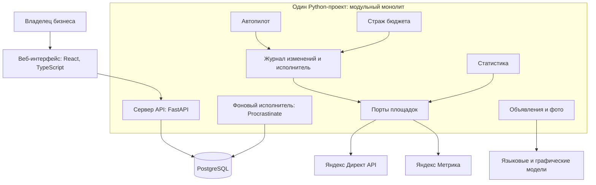
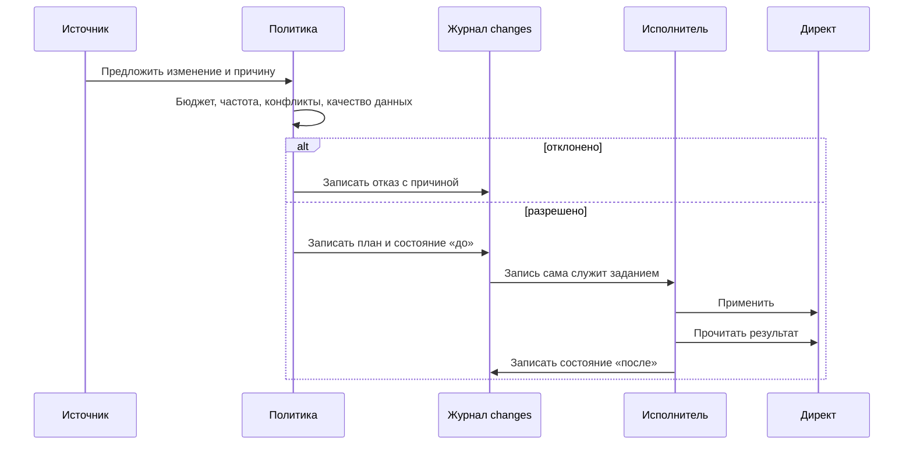
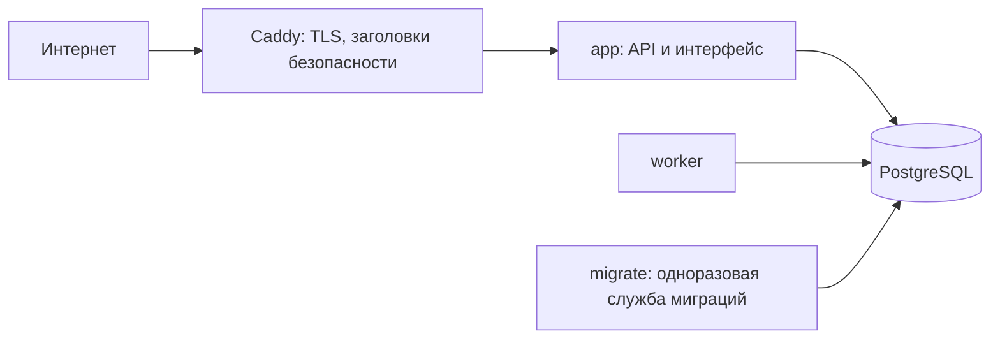

# Архитектура

## Общая схема



Система состоит из трёх запускаемых частей:

| Часть | Что делает |
|---|---|
| **Сервер API** | Отвечает интерфейсу, проверяет сессию и права, читает данные кабинета, принимает действия владельца. Не ходит в Директ напрямую по своей инициативе. |
| **Воркер** | Выполняет фоновые задачи по расписанию: страж бюджета, журнал, автопилот, объявления, чтение сайтов, уведомления. |
| **База PostgreSQL** | Единственное хранилище. Хранит данные, журнал изменений и очередь фоновых задач. |

Веб-интерфейс собирается в статические файлы и отдаётся тем же сервером. На рабочем сервере перед сервисом стоит Caddy: он выпускает сертификат и закрывает служебные адреса.

## Модульный монолит

Весь код живёт в одном проекте и одном образе Docker. Внутри он разделён на модули по предметным областям:

| Модуль | Ответственность |
|---|---|
| `accounts` | Вход через Яндекс, сессии, подключённые кабинеты, зашифрованные токены |
| `business` | Профиль бизнеса, чтение сайта, экономика (сколько стоит клиент) |
| `campaigns` | Модель кампании, регионы, расписание показов, запуск |
| `budget` | План бюджета, период, страж бюджета |
| `ledger` | Журнал изменений: запись, выполнение, откат |
| `platforms` | Реализации портов Директа и поддельная площадка для тестов |
| `stats` | Загрузка и хранение статистики, ленты «Сегодня» и истории |
| `autopilot` | Оценка эффективности, политика, исходы, автооткат |
| `experiments` | A/B-тесты объявлений |
| `creatives` | Генерация объявлений, проверки, фото |
| `commands` | Разбор просьб из чата в закрытый набор команд |
| `notifications` | Тревоги: письмо и Telegram |
| `api`, `worker` | Входы в систему: HTTP и расписание |

Каждый модуль внутри делится на три слоя:

```text
domain        чистые правила и порты (интерфейсы), без HTTP, ORM и SDK площадок
application   сценарии: собирают домен и порты
adapters      реализации портов: SQL, Директ, модели, почта
```

Зависимости идут в одну сторону: `api → application → domain`, а `adapters` реализуют порты из `domain`. Это правило проверяется автоматически на каждом изменении (инструмент `import-linter`, четыре контракта). Нарушение блокирует сборку.

**Зачем так.** Доменный код, где живут деньги и правила, не знает ни про HTTP, ни про формат Яндекса. Поэтому его можно тестировать без сети. Вторая площадка (VK Реклама) потребует нового адаптера, а не переписывания правил.

## Порты площадки

Вместо одного большого интерфейса «рекламная площадка» система использует узкие порты, по одному на задачу. Каждый описан в домене своего модуля нашими понятиями. Версии API Директа (`v5`, `v501`), формат денег и коды ошибок остаются внутри адаптера.

| Порт | Что умеет |
|---|---|
| `BudgetPlatform` | Читать кампании, лимиты, расход и баланс; менять лимит; останавливать и включать кампании |
| `PlatformGateway` | Применять запись журнала к площадке и читать результат |
| `AdControl` | Читать объявление, включать и приостанавливать (удаления нет) |
| `AdPublisher` | Создавать объявления с картинкой, читать итог модерации |
| `AdReports` | Показы, клики, расход и обращения по объявлениям |
| `TargetingControl` | Регионы и расписание показов |
| `CampaignLauncher` | Создавать кампанию запуска |
| `AdvertiserRegistry` | Реквизиты рекламодателя для маркировки |
| `SiteVisits` | Визиты с рекламы из Метрики |

Эти порты реализует адаптер Директа и поддельная площадка тестов. Поддельная площадка позволяет проверять отказы, обрывы и повторы, которые на настоящем Директе воспроизвести нельзя.

## Единый путь изменения

Всё, что меняет Директ, проходит один и тот же путь: автопилот, действие владельца, откат или страж бюджета.



Подробности о гарантиях этого пути в документе [защита денег](02-money-safety.md).

## Данные

Одна база PostgreSQL 16. Схема управляется миграциями Alembic (около сорока версий на сегодня). Ключевые таблицы:

| Таблица | Что хранит |
|---|---|
| `businesses`, `business_profiles` | Бизнес и его профиль: услуги с ценами, адрес, особенности |
| `ad_accounts` | Подключённые кабинеты Директа, токены хранятся зашифрованными |
| `budget_periods`, `spend_snapshots` | Бюджетный период и снимки расхода с моментом, на который они верны |
| `campaigns`, `ads`, `campaign_stats`, `ad_stats` | Витрина состояния и статистики площадки |
| `changes` | Журнал изменений: «до», «план», «после», статус, причина, объяснение, ссылка на откатываемую запись |
| `decisions` | Решения автопилота со входными данными и версией правил |
| `experiments` | A/B-тесты |
| `creative_sets`, `creatives`, `creative_images` | Заказы текстов, объявления, фото |
| `alerts`, `notification_deliveries` | Тревоги и доставка уведомлений |

Три правила работы с данными:

- **Деньги хранятся целыми числами**: микроединицы площадки (миллионные доли рубля) для расхода и лимитов, базисные пункты для долей. Дробных чисел в схеме нет, округление происходит только при показе.
- **Изоляция по бизнесу.** Каждый запрос к данным ограничен `business_id` на уровне репозитория. Чужой бизнес отвечает 404.
- **Журнал только дополняется.** Поля `before`, `planned` и объяснение закрыты от изменения триггером PostgreSQL. Откат создаёт новую запись, а не правит старую.

## Фоновые задачи

Очередь и расписание работают на PostgreSQL (Procrastinate), отдельного брокера нет. Задача ставится в той же транзакции, что и данные, поэтому не теряется при сбое. Основные задачи:

| Задача | Частота | Что делает |
|---|---|---|
| `budget.watch` | каждые 5 минут | Сверяет расход со счётом, останавливает кампании при риске |
| `state.reconcile` | каждые 5 минут | Доводит незавершённые изменения: читает фактическое состояние, затем повторяет или закрывает |
| `autopilot.tick` | каждый час | Запускает разбор кабинетов, которым пора по их расписанию |
| `experiments.run`, `experiments.stats` | час и сутки | Ведёт A/B-тесты и собирает их статистику |
| `ads.keep`, `ads.moderate` | каждые 5 минут | Держит нужное число объявлений, отправляет их на модерацию и разбирает отказы |
| `creatives.generate` | каждую минуту | Пишет тексты по заказам |
| `site.read`, `site.tag_check` | каждую минуту | Читает сайты и ищет код Метрики |
| `notifications.send`, `telegram.poll` | каждую минуту | Рассылает письма и сообщения |

Страж бюджета работает в отдельной очереди и отдельном процессе от долгих задач (генерация, чтение сайтов), поэтому они не задерживают друг друга.

## Развёртывание



Docker Compose поднимает `db`, `migrate`, `app`, `worker` и, на сервере, `caddy`. Приложение стартует после успешных миграций. Тот же образ работает на хостинге (Render) с управляемой базой (Neon): там API и воркеры запускаются одним контейнером. Подробности в [документе об эксплуатации](05-operations.md).
