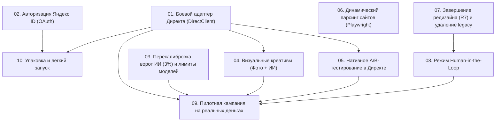

# План задач (Roadmap & Backlog) проекта Ad Helper

Реестр задач на доработку, развитие и подготовку к сдаче сервиса в эксплуатацию.

---

## 1. Карта зависимостей (Dependency Graph)

---

## 2. Сводная таблица задач и оценка сроков (с учетом Claude Code)

> [!NOTE]
> Сроки разработки пересчитаны с учетом высокой скорости автономной разработки в **Claude Code**. Кодовые задачи сокращены с дней до часов/сессий. Сроки, которые ИИ ускорить не может — это внешние процессы: модерация приложений Яндексом (1–7 дней) и физический набор статистики рекламной кампании в пилоте (4 недели).

| ID | Название задачи | Приоритет | Сложность | Трудозатраты (Claude Code) | Календарный срок | Зависит от | Блокирует |
|---|---|---|---|---|---|---|---|
| **[01](01-direct-api-adapter.md)** | Боевой адаптер Яндекс Директ API (`DirectClient`) | **P0 (Критический)** | **Высокая** | **1–1.5 дня** (2–3 сессии) | 2 дня | — (токен есть) | 04, 05, 09, 10 |
| **[02](02-direct-oauth-login.md)** | Авторизация и подключение кабинета Яндекс ID (OAuth 2.0) | **P1 (Важный)** | **Низкая** | **30–45 мин** (тест в браузере) | 0.5 дня | 01 | 10 |
| **[03](03-ai-gate-3-percent-and-limits.md)** | Перекалибровка ворот ИИ (порог 3%) и лимиты моделей | **P0 (Критический)** | **Низкая** | **1–2 часа** (код готов) | 1 день | — (остаток \$0.93 на ключе) | 09 |
| **[04](04-visual-creatives-photos-openrouter.md)** | Визуальные креативы: загрузка фото и OpenRouter (FLUX/Recraft) | **P1 (Важный)** | **Средняя** | **1 день** (1–2 сессии) | 1 день | 01 | 09 |
| **[05](05-native-ab-testing.md)** | Нативное A/B-тестирование внутри групп объявлений | **P1 (Важный)** | **Средняя** | **0.5–1 день** (1 сессия) | 1 день | 01 | 09 |
| **[06](06-dynamic-site-parser-playwright.md)** | Парсер динамических сайтов на JS/Tilda (Playwright) | **P2 (Средний)** | **Средняя** | **0.5–1 день** (1 сессия) | 1 день | — | — |
| **[07](07-frontend-cleanup-r7.md)** | Завершение редизайна (R7) и удаление устаревшего UI | **P1 (Важный)** | **Средняя** | **0.5–1 день** (1–2 сессии) | 1 день | — | 08 |
| **[08](08-human-in-the-loop-mode.md)** | Режим ручной валидации креативов (Human-in-the-Loop) | **P2 (Средний)** | **Низкая** | **3–4 часа** (1 сессия) | 0.5 дня | 07 | 09 |
| **[09](09-live-pilot-validation.md)** | Ведение пилотной кампании (4 недели реальных денег) | **P0 (Критический)** | **Высокая** | **1–2 ч/нед** (мониторинг) | **4 недели открутки** | 01, 03, 04, 05, 08 | Сдача проекта |
| **[10](10-quickstart-and-packaging.md)** | Легкое развертывание и скрипт `quickstart.sh` | **P1 (Важный)** | **Низкая** | **2–3 часа** | 0.5 дня | 01, 02 | Сдача проекта |
| **[11](11-ml-models-selection-and-evals.md)** | ML: Отбор финалистов моделей и прогон ворот 3% | **P1 (Важный)** | **Низкая** | **2–3 часа** | 1 день | — (ключ готов) | 09 |
| **[12](12-ml-prompts-and-site-extraction.md)** | ML: Промпты для FLUX/Recraft и извлекатель фактов | **P1 (Важный)** | **Средняя** | **3–4 часа** | 1 день | 04, 06 | 09 |
| **[13](13-chat-assistant-verification.md)** | Гибридный ИИ-ассистент: аналитика и подтверждение действий | **P1 (Важный)** | **Средняя** | **2–3 часа** | 0.5 дня | 07, 01 | 09 |

---

## 3. Этапы выполнения (Порядок реализации)

### Спринт 1: Разблокировка ядра и ИИ (~2 рабочих дня)
1. `03. Перекалибровка ворот ИИ`: порог 3% и лимит \$1.50 уже внедрены в код; остается запустить прогон `evals.gate` на эталоне после пополнения ключа.
2. `01. Боевой адаптер Директа`: пишем реализацию портов `BudgetPlatform`, `AdPublisher`, `AdControl` для живого API Директа на базе уже подтвержденного рабочего токена `andreimelneichuk` (не дожидаясь стороннего OAuth-приложения).

### Спринт 2: Качество рекламы и стабильность (~2 рабочих дня)
3. `05. Нативное A/B-тестирование`: уходим от посуточного чередования к сплиту внутри групп объявлений Директа.
4. `04. Визуальные креативы`: добавляем загрузку фотографий бизнеса и генерацию подложек через OpenRouter (FLUX / Recraft).
5. `07. Завершение редизайна (R7)`: удаляем старый `cabinet/`, чистим моки.

### Спринт 3: Онбординг и автоматизация (~1.5 рабочих дня)
6. `06. Парсер динамических сайтов`: подключаем headless Playwright для чтения сайтов на Tilda/Taplink.
7. `08. Режим Human-in-the-Loop`: добавляем экран быстрой проверки текстов перед пуском.
8. `02. Авторизация Яндекс ID`: ключи уже добавлены, бэкенд переключился на живой `YandexOAuth`; проводим E2E-тест авторизации и привязки кабинета в браузере.

### Спринт 4: Эксплуатация и сдача (~0.5 дня работы + 4 недели открутки)
9. `10. Легкое развертывание`: скрипт `quickstart.sh` для заказчика.
10. `09. Пилотная кампания`: 4 недели непрерывной открутки на бюджете 15 000 – 20 000 ₽.
